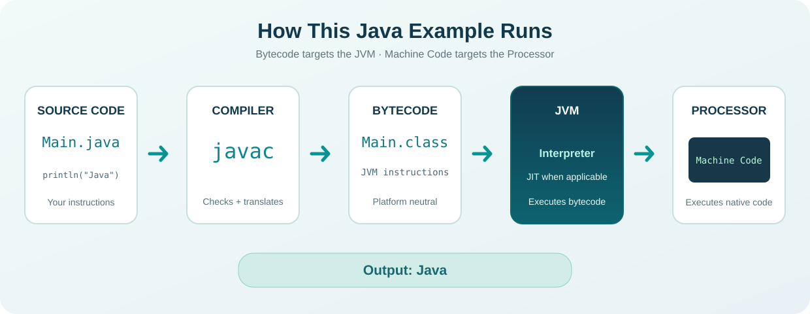

# أهلاً بك في Java Learning Library {.unnumbered}

  THE VISUAL JAVA HANDBOOK
  <h2>تعلّم Java من الصفر. افهمها، جرّبها، وطبّقها.</h2>
  
مش مجرد ملاحظات من فيديوهات. هذا كتاب تراكمي بيشرح ليش بنستخدم كل فكرة، وكيف بتشتغل، وبيربطها بالمشاريع والاختبارات والصور، خطوة بخطوة.

  <a class="hero-btn" href="lessons/lesson-000.html">ابدأ الدرس الأول ←</a>
  
LEARNVISUALIZECODETESTBUILD

 
<strong>77</strong><small>درس أصلي في الخريطة</small>

 
<strong>13</strong><small>وحدة تعليمية</small>

 
<strong>01</strong><small>درس مكتمل كمسودة</small>

## اختر نقطة البداية

 <a class="section-card" href="lessons/lesson-000.html">START HERE · #00<strong>شو هي Java؟ وكيف البرنامج بشتغل؟</strong>
شرح من الصفر + مخطط التنفيذ + أسئلة مع حلول.
</a>
 <a class="section-card" href="roadmap.html">77 LESSON MAP<strong>خريطة المنهج كاملة</strong>
كل فيديو في مكانه مع تقسيم الوحدات والمواضيع والمستويات.
</a>
 <a class="section-card" href="glossary.html">AR · EN<strong>قاموس المصطلحات التراكمي</strong>
المعنى بالعربي ثم التعريف العلمي بالإنجليزي، بدون خلط الاتجاهات.
</a>
 <a class="section-card" href="projects.html">PRACTICE<strong>مشاريع وتطبيقات</strong>
خطة مشاريع تتطور تدريجيًا مع المهارات، ولا ننسبها للمصدر الأصلي.
</a>

## كيف راح نتعلم؟

{fig-alt="خطوات كتابة البرنامج وترجمته إلى Bytecode وتنفيذه على JVM" width="100%"}

في كل موضوع، راح نبدأ من المشكلة اللي بنحاول نحلّها، ثم نشرح الفكرة، وبعدها نشوف صورة أو رسم عند الحاجة، ونكتب مثالًا ونختبره. كل **Subject** ينتهي بامتحان، وكل **Module** بمراجعة وامتحان ومشروع.

::: {.callout-important}
## حالة الكتاب الحالية

استلمنا أسماء المواضيع الأصلية كلها من `#00` إلى `#076`. استلمنا نص الفيديو الأول فقط، ولهذا الدرس `#00` هو الدرس المشروح حاليًا. صفحات بقية المواضيع هي **فهرس انتظار** وليست شرحًا مفترضًا. أي إضافة للتوضيح سنفصلها عن مضمون الفيديو.
:::

## مستويات الكتاب

| المسار | الوحدات | اللي راح تدرسه |
|---|---|---|
| **Beginner** | M01–M06 | البرمجة من الصفر، الشروط، الحلقات، الدوال، المصفوفات |
| **Intermediate** | M07–M11 | OOP، الوراثة، تعدد الأشكال، ArrayList، الواجهات |
| **Applied Core** | M12–M13 | معالجة الأخطاء، الملفات، التخزين |
| **Advanced Java** | لاحقًا | كتب أو وحدات توسّع: Streams، Concurrency، Testing، JDBC، JVM |

**مهم:** المستوى الأخير ليس جزءًا مكتملًا من الـ 77 فيديو؛ سيكون محتوى مستقلًا موثقًا عندما نصل إليه.
