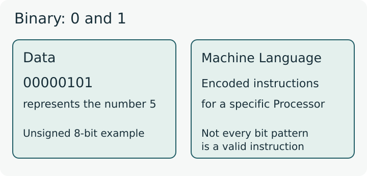
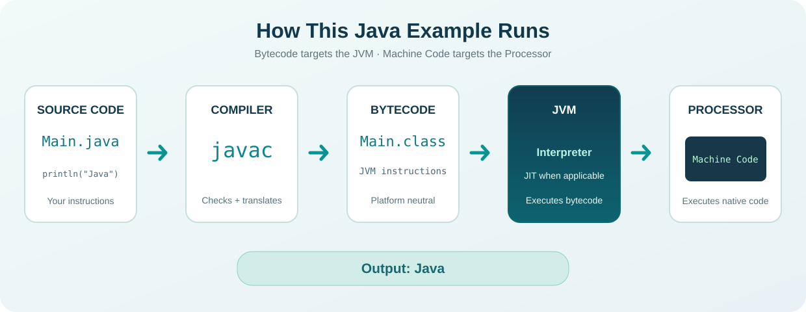

# Introduction to Java

<div class="lesson-meta"><span>BEGINNER</span><span>M01 · S01</span><span>LESSON #00</span></div>

**مرحبا**

هاي بداية رحلتنا مع `Java`. سواء كانت أول مرة تتعلم فيها `Programming`، أو بدك تضيف شيئًا جديدًا لمهاراتك، رح نمشي بالتدريج. مش مطلوب منك تعرف أي شيء مسبقًا؛ اليوم بدنا نفهم الفكرة، وبعدها [نجهّز الأدوات ونطبّق](lesson-001.qmd).

## Learning goals

بنهاية الدرس تقدر تشرح:

- لماذا نحتاج `Programming Languages`؟
- ما معنى `Binary`، وما علاقتها بـ `Machine Language`؟
- كيف تختلف `Source Code` و`Bytecode` و`Machine Code`؟
- كيف تتعاون `Compiler` و`JVM` و`Processor` لتشغيل مثالنا؟
- أين تُستخدم `Java`، وما شروط تشغيل نفس Code على أنظمة مختلفة؟

## Why Programming?

### Computer and Processor

تخيّل بدك تجمع رقمين، تعرض اسمك، أو تحفظ بيانات زبون. الجهاز ما بعرف من حاله شو المطلوب؛ لازم نحدد له الخطوات وترتيبها.

`Computer` هو الجهاز الذي نستخدمه لتنفيذ هذه المهام. وداخله جزء مسؤول عن تنفيذ الأوامر اسمه `Processor`، ويُسمّى أيضًا `CPU`. هذا تعريف مبدئي؛ تفاصيل مكوّناته ليست مطلوبة الآن.

### Instructions and Program

الأمر الذي يحدد عملية ينفذها الجهاز اسمه `Instruction`. ولما نرتّب مجموعة أوامر لإنجاز مهمة، بنبني `Program`.

`Programming` تشمل فهم المطلوب، ترتيب الحل، كتابة Code، وتجربتها للتأكد من النتيجة. إذًا إحنا ما بنتعلم كلمات نحفظها فقط؛ بنتعلم كيف نعطي الجهاز خطوات واضحة.

### Input, Processing and Output

خذ مهمة جمع رقمين:

| Term | الدور في المثال |
|---|---|
| `Input` | القيمتان اللتان نريد جمعهما، مثل `2` و`3` |
| `Processing` | حساب ناتج الجمع |
| `Output` | النتيجة التي نحصل عليها: `5` |

`User` هو الشخص الذي يتعامل مع التطبيق. وإذا عرضنا النتيجة على الجزء المرئي من الجهاز، بنسمي هذا الجزء `Screen`. مش كل Output لازم تكون على Screen؛ مثلًا ممكن نحفظ نتيجة داخل `File`.

## Binary

{fig-alt="Binary uses zero and one to represent both data and instructions. The bit pattern 00000101 represents the unsigned integer five in this data example; it is not a machine instruction for printing." width="100%"}

رسم توضيحي دقيق؛ مثال الرقم هنا لشرح تمثيل البيانات فقط.

على المستوى الرقمي، البيانات والأوامر تُمثّل بحالات نعبّر عنها بـ `0` و`1`. طريقة التمثيل هذه اسمها `Binary`، وكل قيمة مفردة منهما اسمها `Bit`.

مثال بسيط لعدد صحيح غير سالب ممثل بثمانية Bits:

```text
Binary:  00000101
Decimal: 5
```

هذا **تمثيل للرقم خمسة**، وليس أمرًا يطبع الرقم، ولا ترجمة Java إلى Machine Code. نفس مبدأ استخدام Bits يدخل في تمثيل الأرقام والنصوص والأوامر؛ معنى التتابع يعتمد على طريقة تفسيره.

## Machine Language

الـ `Processor` ينفّذ مجموعة محددة من الأوامر المرمّزة بطريقة يفهمها مباشرة. اسمها `Machine Language`، والأوامر المكتوبة بهذا الشكل تُسمّى `Machine Code`.

هذه الأوامر قد تطلب عمليات مثل الجمع أو نقل بيانات. ترميزها مرتبط بنوع `Processor`؛ لذلك لا نفترض أن نفس Machine Code تعمل على كل الأنواع.

**الفرق المهم:** `Binary` طريقة تمثيل باستخدام `0` و`1`، أما `Machine Language` فهي أوامر محددة، لها ترميز ومعنى عند Processor معيّنة. وجود أصفار وآحاد وحده لا يجعل البيانات أوامر قابلة للتنفيذ.

## Programming Languages

هل لازم نكتب كل ما بدنا نعمله كـ Machine Code؟ عمليًا هذا صعب ومرهق عند بناء تطبيقات كاملة.

هون بنستفيد من `High-Level Languages` مثل `Java`: نكتب Code بصيغة أسهل للقراءة والتطوير، ثم تتولى أدوات اللغة وبيئة التشغيل إيصال العمل إلى Processor. عبارة «أسهل للقراءة» لا تعني أن Processor تنفّذ النص المكتوب مباشرةً.

بنسمّي النص الذي يكتبه المطور `Source Code`. والكتابة لازم تتبع قواعد محددة اسمها `Syntax`؛ مش كافي نكتب طلبًا بأي صيغة ونتوقع تنفيذه.

## Why Java?

في لغات كثيرة، ولكل واحدة استخدامات ومميزات وحدود. `Java` مناسبة لتعلّم أساسيات Programming، وبعدها يمكن الاستفادة منها في مجالات مختلفة.

{fig-alt="Java can be used for Desktop, Web Backend, Enterprise and supported Android applications" width="100%"}

### Application Areas

| Area | مثال عملي | ما المقصود؟ |
|---|---|---|
| `Desktop` | تطبيق مبيعات على Computer | تطبيق يتعامل معه الشخص على الجهاز |
| `Web Backend` | استقبال طلبات موقع وحساب النتائج | الجزء الذي يعمل على `Server`؛ أي ما يقدّم خدمات ويستجيب للطلبات |
| `Enterprise` | أنظمة حسابات ومشتريات ومبيعات مترابطة | أنظمة تخدم احتياجات مؤسسة كبيرة |
| `Android` | تطبيق يعمل على هاتف متوافق | Java مدعومة؛ تفاصيل تطوير الهاتف تأتي بعد الأساسيات |
| `Embedded` | تطبيقات لبعض الأجهزة الخاصة | فقط عندما تدعم الأجهزة وبيئاتها تقنيات Java المناسبة |

`Browser` هو التطبيق الذي نفتح منه المواقع. في استعمال `Web Backend` المذكور هنا، تعمل Java على Server، وليست بديلًا عن `HTML` التي تصف محتوى صفحات الموقع.

### Library and Framework

`Library` توفّر Code جاهزة نستخدمها بدل بناء كل شيء من البداية. أما `Framework` فتوفر بنية وأدوات تساعدنا على تنظيم التطبيق وبنائه.

من الأسماء التي قد تراها: `Swing` و`JavaFX` لبناء واجهات Desktop، مثل النوافذ والأزرار. هذا هو المقصود بـ `User Interface` أو `UI`. المطلوب الآن معرفة دورها العام، وليس تعلّم استخدامها.

### Security and Encryption

توفر Java أدوات لدعم `Security`، ومنها `Encryption`: تحويل البيانات إلى شكل لا يُقرأ بصورته الأصلية، واستعادتها بالطريقة والمفتاح المناسبين. هذه الأدوات تساعد على حماية البيانات، لكنها لا تجعل كل تطبيق آمنًا تلقائيًا. اليوم نذكر هذا الاستخدام فقط، بدون الدخول في خوارزمياته.

## Object-Oriented Programming

<span class="english-term">Object-Oriented Programming · OOP</span>

إحدى طرق تنظيم Code في Java تعتمد على `Objects` تجمع معلومات وسلوكًا مرتبطًا بها. مثلًا، قد نمثّل طالبًا بمعلوماته والعمليات المتعلقة به.

يكفي تتعرف على الاسم والفكرة العامة الآن؛ [Classes & Objects](../subjects/s15.qmd) لها شرحها الخاص لاحقًا.

## Writing Java

بدنا نعرض كلمة `Java`. هذا مثال كامل، محفوظ باسم `Main.java`، وبدون `Package` معلنة أو Input:

```java
public class Main {
    public static void main(String[] args) {
        System.out.println("Java");
    }
}
```

**Output**

```text
Java
```

السطر `System.out.println("Java");` يطلب طباعة النص بين Double Quotes، ثم الانتقال إلى سطر جديد. `System.out` هي جهة `Standard Output` التي يظهر محتواها عادةً في Console؛ وهي مساحة عرض نصية نرى فيها نتائج التشغيل.

لا يلزم الآن حفظ باقي الرموز؛ سنتعلمها بالتدريج. وجود المثال هنا يربط الفكرة بما سنشغّله بعد [تثبيت أدوات Java](lesson-001.qmd).

## How Java Runs

{fig-alt="Main.java is compiled by javac into Main.class containing Bytecode. A compatible JVM uses interpretation and possibly JIT compilation; the Processor executes native Machine Code. The visible Output of this example is Java." width="100%"}

رسم تخطيطي لمسار مثالنا؛ لا يعرض Bits زائفة باعتبارها ترجمة فعلية للـ Code.

### Source Code

نكتب المثال ونحفظه في `Main.java`. هذا هو النص الذي يستطيع المطور قراءته وتعديله.

### Compiler

<span class="english-term">Java Compiler · javac</span>

تقرأ هذه الأداة Source Code، وتفحص قواعد الكتابة والأنواع، ثم تُنتج الصيغة التالية عند نجاح العملية. الاسم الذي نستخدمه لاستدعاء Java Compiler هو `javac`.

إذا أخطأنا في Syntax قد تفشل هذه الخطوة. ونجاحها لا يثبت صحة منطق الحل؛ ممكن Code تنفّذ حسابًا مختلفًا عن المطلوب. هذا اسمه `Logical Error`.

### Bytecode

في مثالنا، ينتج `Main.class`. **هذا اسم File، ومحتواها يتضمن Bytecode ومعلومات أخرى لازمة للتشغيل.**

Bytecode هي Instructions موجّهة إلى `JVM`، وليست Machine Code الخاصة بـ Processor الفعلية. الاثنتان قد تُمثّلان بشكل Binary، لكنهما تستهدفان نوعين مختلفين من التنفيذ.

### JVM

<span class="english-term">Java Virtual Machine · JVM</span>

في التشغيل المعتاد على Computer، هذه بيئة برمجية تنفّذ Bytecode، وتربطها بالجهاز وOperating System المناسبين. لا يقرأ Processor النص `System.out.println` مباشرةً.

#### Interpreter

يقرأ Bytecode ويطبّق عملياتها أثناء التشغيل. والـ Interpreter نفسها جزء من Runtime يعمل بتعليمات Machine Code التي تنفّذها Processor.

#### Just-In-Time Compiler

<span class="english-term">Just-In-Time Compiler · JIT Compiler</span>

قد تحوّل هذه الأداة أجزاء من Bytecode إلى Machine Code أثناء التشغيل، خصوصًا الأجزاء المتكررة، لتحسين الأداء. قد تجمع JVM بين هذه الطريقة وInterpreter؛ **لا نفترض أن كل Bytecode يجب تحويلها مسبقًا بالكامل**.

هذه معرفة بدور الأداتين فقط؛ لا نحتاج تفاصيلهما الداخلية الآن.

### Processor and Output

في النهاية، الذي تنفّذه Processor الفعلية هو Machine Code الملائمة لها. وبسبب أمر الطباعة في مثالنا، يظهر النص `Java` في Console.

| Representation | مَن يتعامل معها في مثالنا؟ |
|---|---|
| `Source Code` | يكتبها المطور، وتقرأها `javac` |
| `Bytecode` | تنتجها `javac` وتنفّذها `JVM` |
| `Machine Code` | تنفّذها `Processor` الفعلية |

هيك صار واضح ليش ما بنعتبر الثلاثة نفس الشيء، حتى لو كانت جميعها مخزّنة رقميًا باستخدام Bits.

## Write Once, Run Anywhere

<span class="english-term">Write Once, Run Anywhere · WORA</span>

الفكرة أن نفس Bytecode ممكن تعمل على أنظمة مختلفة، إذا توفرت JVM متوافقة مع الجهاز، وOperating System، وإصدار Bytecode، وبقية احتياجات التطبيق.

`Operating System` يدير موارد الجهاز ويوفّر خدمات للتطبيقات؛ من أمثلته `Windows` و`macOS` و`Linux`. لكل بيئة تنفيذ JVM مناسبة لها؛ **مش نفس نسخة JVM تعمل على كل الأنظمة**.

إذًا الذي ننقله بين البيئات في هذا النموذج هو Bytecode. وإذا اعتمد التطبيق على Library خاصة بنظام معيّن، فقد يحتاج تعديلًا ليعمل على نظام آخر. الشعار لا يعني تشغيل أي تطبيق على أي جهاز بلا شروط.

## Java Editions & Technologies

| Name | الدور العام |
|---|---|
| `Java SE` | الأساس العام للغة وLibraries، وهو الذي نبدأ به هنا |
| `Jakarta EE` | مواصفات لبناء تطبيقات Enterprise وخدمات Server؛ امتداد لمسار كان يُعرف بـ `Java EE` |
| `Java ME` | تقنيات لأجهزة وبيئات محددة، منها أجهزة محدودة الموارد؛ ليست مرادفًا لكل تطوير Mobile |
| `JavaFX` | أدوات وLibraries لبناء Desktop UI؛ ليست Programming Language أو إصدارًا من Java SE |

**توضيح حديث:** `Kotlin` هي Programming Language أخرى تدعمها أدوات Android، وتتبنى Google نهج `Kotlin-first`، مع استمرار دعم Java. هذه ملاحظة لتصحيح الصورة العامة، وليست موضوعًا مطلوبًا لتبدأ هذا الكتاب.

## How to Study

اختَر وقتًا تكون فيه مركزًا، واقرأ للفهم مش لزيادة عدد الصفحات. بعد كل فكرة حاول تشرحها بكلماتك. وعندما نجهّز الأدوات، طبّق الأمثلة وجرّب تغييرًا صغيرًا وتوقّع نتيجته.

لا يلزم إتقان كل اسم جديد اليوم؛ المهم تعرف وظيفة الأجزاء وكيف ترتبط. سنعود للتفاصيل عندما نحتاجها.

## Knowledge Check

1. لماذا نحتاج Programming Languages بدل كتابة كل تطبيق كـ Machine Code؟
2. هل `Binary` و`Machine Language` نفس الشيء؟ فسّر بمثال `00000101` في هذا الدرس.
3. ما الفرق بين `Source Code` و`Bytecode` و`Machine Code`؟
4. في مثالنا، ما دور `javac`؟ وما اسم File الناتجة؟ وهل اسمها Bytecode؟
5. ما دور JVM؟ وما الفرق العام بين Interpreter وJIT Compiler؟
6. ما الذي تنفّذه Processor الفعلية في التشغيل المعتاد؟ وما Output مثالنا؟
7. ماذا تعني WORA؟ هل نستخدم نفس نسخة JVM لكل Operating System؟
8. هل نجاح Compiler يضمن أن الحسابات صحيحة؟ وهل وجود أدوات Security يجعل التطبيق آمنًا تلقائيًا؟
9. اذكر ثلاثة استخدامات لـ Java، وفسّر دور Library أو Framework بجملة.
10. هل JavaFX لغة منفصلة؟ وهل Java ME تعني كل تطبيقات Android؟

<details><summary>Answers</summary>

1. لأنها أسهل للقراءة والتطوير، ثم تتولى الأدوات وRuntime إيصال العمل إلى Processor.
2. لا؛ الأولى طريقة تمثيل بـ `0` و`1`، والثانية أوامر محددة لـ Processor. التتابع المعروض هنا يمثل العدد `5`، وليس أمر طباعة.
3. الأولى Code يكتبها المطور؛ الثانية Instructions لـ JVM؛ الثالثة Instructions تنفّذها Processor الفعلية.
4. تفحص Source Code وتحولها إلى Bytecode؛ تنتج `Main.class` التي تتضمن Bytecode ومعلومات أخرى. Bytecode ليست اسم File.
5. تنفّذ Bytecode؛ Interpreter تطبّق عملياتها أثناء التشغيل، وJIT Compiler يمكن أن تحوّل أجزاء منها إلى Machine Code أثناء التشغيل.
6. Machine Code الملائمة لها؛ وOutput هي `Java` ثم سطر جديد.
7. تشغيل نفس Bytecode في بيئات متوافقة؛ لا، يلزم تنفيذ JVM مناسب لكل بيئة وإصدار مدعوم واحتياجات متوفرة.
8. لا في الحالتين؛ قد يبقى Logical Error، وSecurity تحتاج استعمال الأدوات وتصميم التطبيق بطريقة صحيحة.
9. مثل Desktop وWeb Backend وEnterprise. Library توفّر Code جاهزة، وFramework توفّر بنية وأدوات لتنظيم البناء.
10. لا؛ JavaFX لتطوير UI، وJava ME لبيئات وأجهزة محددة، وليست منصة Android العامة.

</details>

## Related Terms

[Binary](../glossary.qmd#binary) · [Machine Language](../glossary.qmd#machine-language) · [Processor](../glossary.qmd#processor) · [Compiler](../glossary.qmd#compiler) · [Bytecode](../glossary.qmd#bytecode) · [JVM](../glossary.qmd#java-virtual-machine).

## Source & Additions

يغطي الدرس: معنى Programming، سبب استعمال High-Level Languages، Binary وMachine Language، مجالات Java ومنها Security، OOP تمهيديًا، مسار التشغيل، WORA، تقنيات Java، ونصائح الدراسة.

المثال الكامل والرسوم والأسئلة إضافات تعليمية ضمن نفس الأفكار. شرح Interpreter وJIT المختصر يوضّح علاقة Bytecode بـ Machine Code، ولا يفتح موضوعًا متقدمًا مستقلًا. المثال الكامل جُرّب عبر `JDK 25 CLI`؛ تنفيذ NetBeans يأتي في الدرس التالي.

مراجع الدقة: [JVM Specification](https://docs.oracle.com/javase/specs/jvms/se25/html/jvms-1.html#jvms-1.2) · [Java Cryptography](https://docs.oracle.com/en/java/javase/25/security/java-cryptography-architecture-jca-reference-guide.html) · [JavaFX](https://openjfx.io/) · [Android Kotlin-first](https://developer.android.com/kotlin/first).

## Continue Learning

[Lesson #01 — Java Development Tools](lesson-001.qmd): تجهيز الأدوات وإنشاء أول Project وتشغيله.
