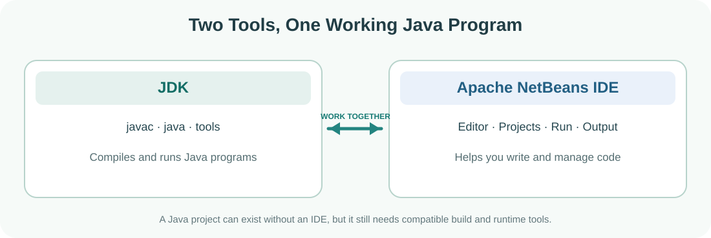
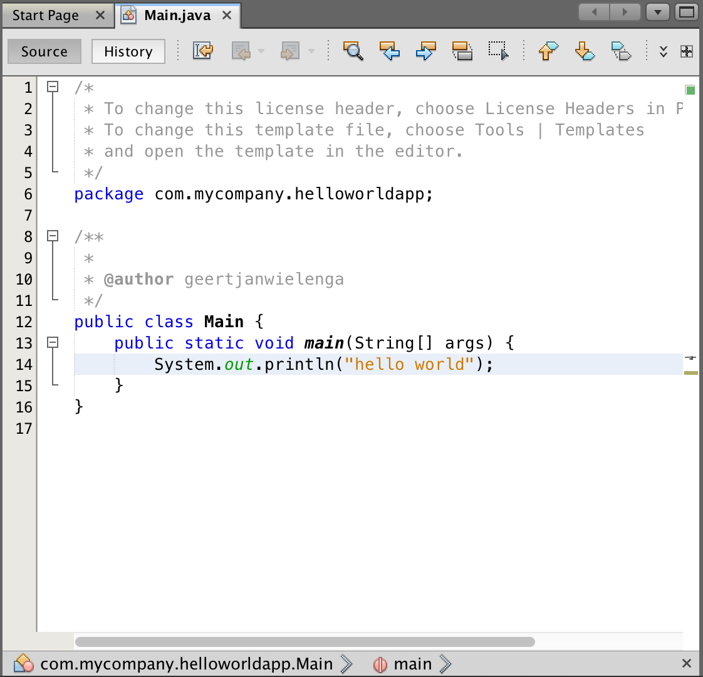
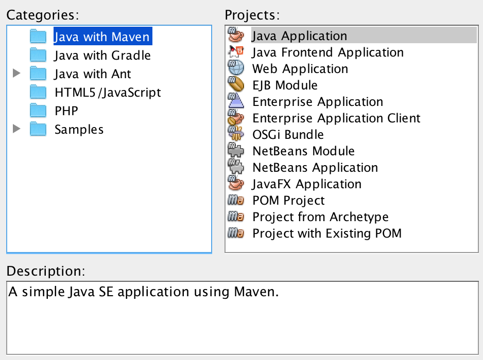
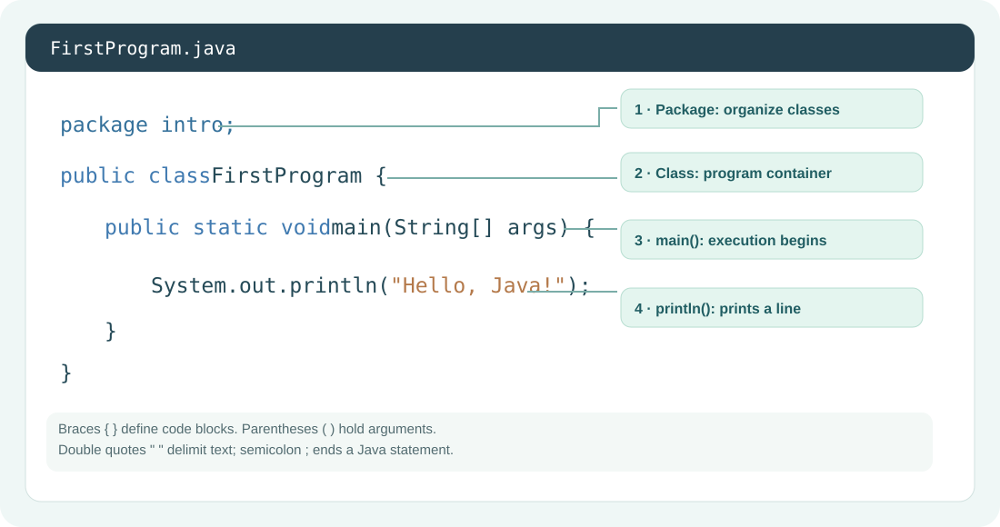
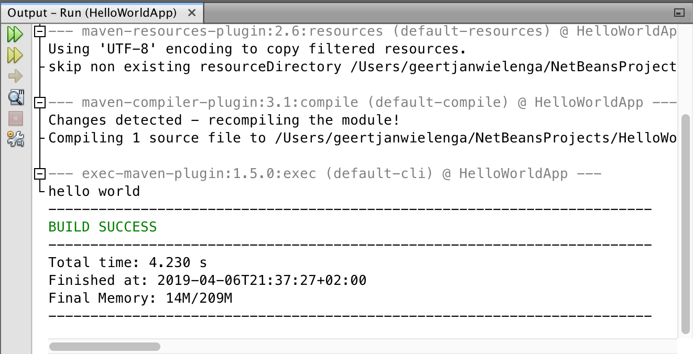
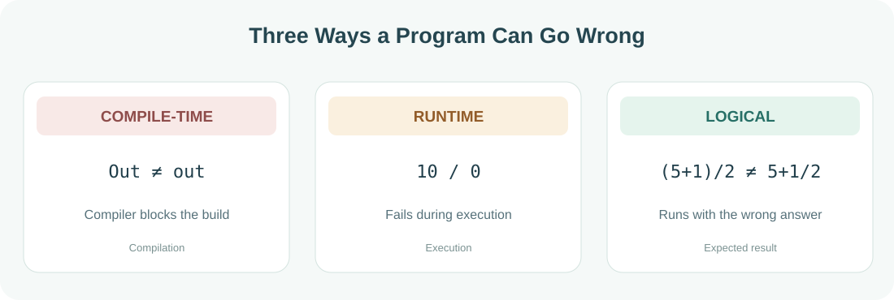

# Java Development Tools

<div class="lesson-meta"><span>BEGINNER</span><span>M01 · S01</span><span>LESSON #01</span></div>

<div class="lesson-banner">

**مرحبا**

في [Introduction to Java](lesson-000.qmd) عرفنا شو هي Java وكيف ممكن تتحوّل التعليمات اللي بنكتبها إلى برنامج شغّال. هسا بدنا نعمل أهم خطوة: نجهّز الكمبيوتر، نفتح البيئة اللي رح نكتب فيها، ونشغّل أول برنامج بأيدينا. حتى لو المصطلحات جديدة عليك، ما راح نحفظها بدون ما نفهم دورها.

</div>

## Learning goals

1. ليش نحتاج أداتين مختلفتين؟ وشو وظيفة كل واحدة؟
2. كيف نثبت JDK وApache NetBeans ونفحص التثبيت؟
3. كيف ننشئ Project وPackage وClass ونفهم العلاقة بينها؟
4. كيف نكتب أول برنامج ونشغّله؟
5. شو معنى `main` و`System.out.println` وأهم علامات الكتابة؟
6. كيف نفرّق بين ثلاثة أنواع من الأخطاء، ونحلّها؟

## JDK & IDE

{fig-alt="مخطط يوضح أن JDK يقدم أدوات الترجمة والتشغيل، وأن NetBeans IDE يساعد في كتابة وتنظيم وتشغيل Project" width="100%"}

### JDK

<span class="english-term">Java Development Kit · JDK</span>

لما بدك تطوّر برنامج Java، أنت بحاجة لأدوات تفهم Code وتترجمه وتشغّله. مجموعة الأدوات اللي بتوفّر أدوات التطوير هاي اسمها **JDK**. ومن الأدوات الموجودة فيها Compiler `javac` وبرنامج تشغيل Java.

تخيّل إنك بدك تبني بيت: مجرد الورقة اللي عليها المخطط ما بتكفي؛ بدك أدوات شغل. الـ JDK هي أدوات البناء والتنفيذ بالنسبة لبرامج Java.

### IDE

<span class="english-term">Integrated Development Environment · IDE</span>

طيب وين رح نكتب Code؟ ممكن تكتبه في `Text Editor`، لكن رح يكون الموضوع أصعب. عشان هيك بنستخدم برنامج بيساعدنا نرتّب `Files`، نكتب الأوامر، نشوف الأخطاء، ونشغّل `Project` بسهولة.

بالكورس رح نستخدم **Apache NetBeans**. الـ IDE مش هو لغة Java، ومش بديل عن JDK؛ هو `User Interface` مريحة بتستخدم أدوات التطوير الموجودة عندك.

::: {.callout-tip}
## كيف تميّز بينهم بسرعة؟

- **JDK:** الأدوات اللي بتترجم وتشغّل البرامج.
- **NetBeans IDE:** البرنامج اللي بتكتب فيه وبتنظّم `Project` الخاص فيك.
- **Java:** Programming Language نفسها.

:::

## Installing the Tools

هاي الخطوات توضّح تثبيت الأدوات بإصدار محدد؛ شكل `User Interface` ممكن يختلف حسب الإصدار.

### أولًا: JDK على Windows

أقترح نسخة **Eclipse Temurin JDK 25 LTS** المجانية لهذا الكتاب؛ مناسبة للتعلّم ويدعمها Apache NetBeans 31.

1. افتح الموقع الرسمي: [Download Eclipse Temurin JDK](https://adoptium.net/temurin/releases/).
2. اختر `JDK 25 (LTS)`، ثم `Windows` و`x64` إذا كان جهازك بنظام Windows 64-bit على `Processor` Intel أو AMD.
3. حمّل `File` التثبيت `.msi` ثم شغّله وأكمل خطوات التثبيت.
4. افتح نافذة أوامر جديدة من قائمة Start، واكتب:

```powershell
java -version
javac -version
```

إذا ظهر رقم إصدار لكل أمر، معناها النظام قادر يوصل لأدوات Java. إذا ظهر أن الأمر غير معروف، راجع تثبيت JDK وإعدادات `PATH`، ثم افتح نافذة أوامر جديدة.

**بديل سهل من Windows Terminal** — إذا كان `winget` مثبتًا:

```powershell
winget install EclipseAdoptium.Temurin.25.JDK
```

على macOS أو Linux اختَر `File` التنزيل المناسب لجهازك من نفس موقع Adoptium، بدل تنزيل `File` Windows.

### ثانيًا: Apache NetBeans

1. افتح [صفحة Apache NetBeans الرسمية](https://netbeans.apache.org/front/main/download/).
2. اختر الإصدار المناسب للـ `Operating System`. هذا الدرس يستخدم **NetBeans 31**؛ راجع صفحة التنزيل لمعرفة الإصدار المتاح لنظامك.
3. إذا نزّلت `File` `netbeans-31-bin.zip` الرسمي، استخرجه واتبع تعليمات تشغيل النسخة الخاصة بنظامك.
4. فيه مُثبّتات سهلة من مجتمع NetBeans مذكورة على الموقع الرسمي، وبعضها يحتوي على JDK لتشغيل الـ IDE. هاي `Files` التثبيت من جهات مساهمة وليست `Files` تثبيت صادرة مباشرة عن Apache.
5. شغّل NetBeans. إذا طلب تحديد JDK، اختر النسخة التي ثبّتها الجهاز.

::: {.callout-note}
## ليش ممكن يختلف شكل الشاشة عندك؟

لأن شكل `User Interface` يتغير بين الإصدارات. المطلوب منك تفهم الأداة وتعرف مكان الخيارات، مش تحفظ صورة قديمة. الخطوات ممكن تختلف قليلًا حسب إصدار NetBeans ونوع `Project`.

:::

## The NetBeans Workspace

{fig-alt="Genuine Apache NetBeans tutorial Screenshot showing Main.java, package, main and println in the Editor" width="100%"}

هذه Screenshot حقيقية من [الدليل الرسمي](https://netbeans.apache.org/tutorial/main/kb/docs/java/quickstart/). تعرض مثالًا باستخدام Maven؛ نستخدمها للتعرّف على Editor، وليست Screenshot من NetBeans 31 أو من `Project` Ant الذي سنبنيه هنا. اضغط الصورة لعرضها بحجمها الأصلي.

أما الرسم التالي فهو مخطط تعليمي لأماكن العمل الأساسية:

<div class="visual-frame">

{fig-alt="رسم تخطيطي تعليمي وليس لقطة حقيقية؛ يحدد Projects وEditor وOutput وRun في Interface تشبه بيئة NetBeans" width="100%"}

</div>

**مهم:** هذه **محاكاة توضيحية** لتوزيع أجزاء `User Interface` وليست Screenshot حقيقية من برنامج NetBeans. تقدر تفتح [الشرح الرسمي لتنظيم `Projects`](https://netbeans.apache.org/tutorial/main/kb/docs/java/javase-intro/) للمقارنة مع صور NetBeans الأصلية. وفي الأسفل Screenshots حقيقية من الدليل الرسمي، مع توضيح اختلاف `Project` المعروض.

اللي يهمنا حاليًا أربع أماكن:

- **Projects:** وين بنشوف `Project` و`Files` الخاصة فيه.
- **Editor:** المساحة اللي بنكتب فيها Code.
- **Run:** خيار تشغيل البرنامج.
- **Output:** المكان اللي بنشوف فيه النتيجة ورسائل التشغيل.

## Your First Project

<span class="english-term">Project · Package · Class · Java Source File</span>

تخيّل إنك بدك تعمل برنامج لمحل. مش منطقي تحط كل شيء في `File` واحد وتسميه عشوائيًا. حتى في أول مثال بسيط، نتعلم ننظّم شغلنا.

{fig-alt="شجرة مبسطة توضّح أن Project يحتوي على Folder مصدر، وpackage اسمها intro، وFile FirstProgram.java الذي يحتوي public class FirstProgram" width="100%"}

### Create a Project

{fig-alt="Official NetBeans New Project wizard Screenshot; the guide selects Java with Maven, while this lesson selects Java with Ant" width="100%"}

النافذة من الدليل الرسمي تعرض Maven. في خطواتنا التالية اختر **Java with Ant** بدلًا منه؛ الهدف هنا معرفة نافذة الاختيار، وليس نسخ الإعداد الظاهر في الصورة.

1. من القائمة اختر `File → New Project` أو على Windows اضغط `Ctrl + Shift + N`.
2. ضمن الفئات، اختر `Java with Ant`، ثم `Java Application`. هذا هو المسار التقليدي الموافق للمادة. لو شفت `Java with Maven` أو `Java with Gradle`، فهي أنظمة بناء أخرى مش مطلوب نفهمها الآن.
3. اضغط `Next`، وسمّ `Project` `MyFirstJava`.
4. حدد مكان الحفظ. إذا ظهرت خانة `Create Main Class`، عندك خيار تتركها مفعلة أو تنشئ الـ Class بنفسك. **لهذا المثال، سننشئها يدويًا** حتى نفهم الخطوات.
5. اضغط `Finish`.

### Create a Package & Class

من نافذة `Project`:

1. افتح `Source Packages` إن كانت موجودة.
2. أنشئ `Java Package` باسم `intro` إذا لم تكن موجودة.
3. اضغط بالزر اليمين على Package، ثم `New → Java Class`.
4. سمّ الـ Class باسم `FirstProgram` واضغط `Finish`.

هسا رح يظهر `File` جديد اسمه:

```text
FirstProgram.java
```

::: {.callout-warning}
## قواعد التسمية المهمة الآن

- الاسم `FirstProgram` بلا مسافات، ويبدأ بحرف كبير لأنه اسم Class وفق أسلوب Java المعتاد.
- اسم Package `intro` بحروف صغيرة.
- لما نكتب `public class FirstProgram`، لازم يكون `File` `FirstProgram.java` بنفس الأحرف الكبيرة والصغيرة.
- شرط التطابق يخص الـ `public top-level class` تحديدًا، مش كل Class ممكن تكتبها بأي `File`.
- تسمية `MyFirstJava` للـ `Project` اختيار تنظيمي، مش شرط من Java نفسها.

:::

## Your First Java Class

هاي النسخة الكاملة اللي راح نشتغل عليها. إذا NetBeans أنشأ سطر `package intro;` تلقائيًا، لا تكرره؛ اكتبه فقط إذا لم يكن موجودًا.

```java
package intro;

public class FirstProgram {
    public static void main(String[] args) {
        System.out.println("Hello, Java!");
    }
}
```

**النتيجة المتوقعة:**

```text
Hello, Java!
```

<div class="visual-frame">

{fig-alt="رسم يوضح البنية الرئيسية لبرنامج Java بسيط مع توضيح class و main method و System.out.println و الفواصل المنقوطة" width="100%"}

</div>

### Reading the Code

**أولًا — Package**

```java
package intro;
```

هذا السطر بحدّد Package اللي بينتمي إلها `File`. Package بتساعدنا ننظم مجموعة Classes مرتبطة ببعض. حاليًا Package واحدة بتكفي.

**ثانيًا — Class**

```java
public class FirstProgram {
}
```

Class هي بنية لتنظيم أجزاء البرنامج. كل اللي بدنا نكتبه في هذا المثال موجود داخل Braces الخاصة فيه.

**ثالثًا — Main Method**

```java
public static void main(String[] args) {
}
```

هذا هو سطر نقطة البداية التقليدية لتطبيق Java اللي بنشغّله كبرنامج مستقل. مش لازم تحفظ معنى كل كلمة الآن؛ راح نشرح `public` و`static` و`void` و`String[] args` بالتفصيل في مواضيعها.

اللي عليك تعرفه الآن:

- `main` هو الاسم المعيّن لنقطة دخول هذا النوع من البرامج.
- الأقواس `()` مرتبطة بتعريف الـ Method والـ Parameters الخاصة بها.
- الأقواس `{}` بتحدد الأوامر الموجودة داخل الـ Method.
- كلمة `args` اسم يمكن تغييره، لكننا سنبقيه كما هو متعارف عليه.

**رابعًا — أمر الطباعة**

```java
System.out.println("Hello, Java!");
```

إحنا بدنا نطبع نص. لذلك بنستخدم `System.out.println`. النص الموجود بين Double Quotes هو اللي رح يظهر على الشاشة، وبعده ينتقل المؤشر لسطر جديد.

> `System` عبارة عن Class، و`out` Field يشير إلى `Standard Output`، و`println` إحدى Methods الخاصة بالطباعة. هاي التفاصيل رح تصير أوضح لما نوصل لمواضيع Classes وMethods.

**خامسًا — Semicolon**

```java
;
```

Semicolon بتنهي هذا النوع من `Statements`. نسيانها بعد أمر الطباعة يسبب Compile-Time Error.

## Run & Output

{fig-alt="Genuine official Screenshot of NetBeans Output window after running the tutorial Maven project" width="100%"}

هذه Screenshot من مثال Maven في الدليل الرسمي. قد تختلف رسائل البناء، لكن Output هو المكان الذي ستشاهد فيه النتيجة ورسائل التشغيل.

احفظ `File` من `File → Save`، أو اضغط `Ctrl + S` على Windows، ثم شغّل `Project` من:

```text
Run → Run Project
```

أو اضغط `F6` في إعدادات الاختصارات المعتادة.

إذا ظهرت نافذة تطلب تحديد الـ `Main Class`، اختَر `intro.FirstProgram`. بعد التشغيل افتح تبويب `Output`، وشوف النص اللي طبعناه.

إذا ظهرت رسالة نجاح بناء أو تشغيل، فهذا يعني إن الإجراءات المرتبطة بالبناء أو التشغيل انتهت بدون الخطأ الذي يمنع إتمامها. لكن هذا **مش دليل لوحده أن منطق برنامجك صحيح**.

## Three Types of Errors

هذا الجزء مهم جدًا، لأننا نميّز بين أخطاء تظهر قبل التشغيل وأثناء التشغيل، وأخطاء ما تعطيك رسالة رغم أن الناتج غلط.

{fig-alt="ثلاث لوحات تقارن بين Compile-Time Error الذي يمنع البناء، وخطأ Runtime الذي يوقف التنفيذ، وLogical Error الذي يعطي نتيجة غير مقصودة" width="100%"}

### Compile-Time Error

<span class="english-term">Compile-Time Error</span>

بنعمل غلط في الكتابة أو في قاعدة من قواعد اللغة، فيكتشفه الـ Compiler ويمنع البرنامج من الترجمة.

جرب **عمداً** تكتب:

```java
System.Out.println("Hello");
```

ليش غلط؟ لأن `Out` مش هو نفسه `out`؛ لغة Java حسّاسة للحروف الكبيرة والصغيرة.

**الحل:**

```java
System.out.println("Hello");
```

### Runtime Error

<span class="english-term">Runtime Error</span>

أحيانًا Code بنترجم بدون مشكلة، لكن لما يشتغل بنعمل عملية غير مسموحة. مثال:

```java
int number = 0;
System.out.println(10 / number);
```

لما ننفّذ البرنامج، رح يحدث خطأ قسمة صحيحة على صفر:

```text
java.lang.ArithmeticException: / by zero
```

**المهم:** الخطأ ظهر وقت التنفيذ، مش لأننا كتبنا اسم Method غلط. مش كل برامج Java بترتكب نفس الخطأ بنفس الطريقة، لكن المثال فوق يوضح الفكرة.

### Logical Error

<span class="english-term">Logical Error</span>

هذا أخطر نوع بالنسبة للمبتدئ أحيانًا: برنامجك بترجم وبشتغل، بس الناتج مش المطلوب.

تخيّل بدك تجمع 5 مع 1 وبعدين تقسّم على 2:

```java
System.out.println((5 + 1) / 2);
```

**الناتج:**

```text
3
```

شو لو نسيت الأقواس؟

```java
System.out.println(5 + 1 / 2);
```

**الناتج:**

```text
5
```

ليش؟ لأن القسمة إلها أولوية أعلى من الجمع، و`1 / 2` بين عددين صحيحين تعطي `0`. بعدين `5 + 0 = 5`.

البرنامج مش عارف إنك كنت تقصد `3`، لأنه نفّذ الأمر اللي إنت كتبته بشكل صحيح. إذًا المشكلة في منطق الحل.

::: {.callout-important}
## امتحان مصغّر في الفكرة

| الحالة | متى نكتشفها؟ |
|---|---|
| أمر مكتوب بشكل لا يفهمه Compiler | Compile-Time |
| خطأ يظهر فقط عند التنفيذ | Runtime |
| البرنامج يشتغل، لكن النتيجة مختلفة عن المقصود | Logical |

:::

## Case Sensitivity & Keywords

<span class="english-term">Case Sensitivity · Keywords · Identifier</span>

Java بتفرّق بين `System` و`system`، وبين `out` و`Out`. فما بصير نغيّر شكل الكلمات بشكل عشوائي.

وفي كلمات إلها دور خاص باللغة، زي `public` و`class` و`static`. هاي اسمها **Keywords** وما بنستخدمها كأسماء عادية للVariables أو Classes. بعض الكلمات مثل `main` أسماء مهمة باتفاقات اللغة وبيئة التشغيل، لكن مش كلها Java Keywords.

## Practice

ابنِ برنامجًا باسم `FirstProgram` يطبع ثلاث رسائل على ثلاثة أسطر. جرب تغيّر النصوص والأرقام وشوف النتيجة.

```java
package intro;

public class FirstProgram {
    public static void main(String[] args) {
        System.out.println("I am learning Java.");
        System.out.println("My first project works!");
        System.out.println((5 + 1) / 2);
    }
}
```

**الناتج المتوقع:**

```text
I am learning Java.
My first project works!
3
```

### جرّب بنفسك

1. استبدل الجملة الأولى بأي جملة من اختيارك.
2. احذف آخر `;` من أحد أسطر الطباعة، وشوف وين يظهر الخطأ. بعدين رجّعه.
3. غيّر `println` إلى `Println` وشوف النتيجة، ثم صحّحها.
4. قارن بين `(8 + 2) / 2` و`8 + 2 / 2`. توقّع الناتج قبل التشغيل.

## Knowledge Check

**أ — فهم:** ما الفرق بين JDK وIDE؟ وليش ما بكفي نفتح `Text Editor`؟

**ب — ترتيب:** رتب العناصر التالية ضمن بنية `Project`: `Project`، `Java File`، `Package`.

**ج — تسمية:** هل يصلح اسم `public class First Program`؟ ليش؟

**د — تتبع:** أين يبدأ التنفيذ في المثال التقليدي الذي تعلمناه؟

**هـ — إصلاح:** صحّح السطر:

```java
system.out.println("Java")
```

**و — تفسير:** إذا البرنامج كتب رسالة `BUILD SUCCESSFUL` لكنه طبع رقمًا غلطًا، ما نوع المشكلة المرجّحة؟

**ز — حساب:** ما ناتج المثالين؟ وليش مختلفين؟

```java
System.out.println((8 + 2) / 2);
System.out.println(8 + 2 / 2);
```

<details><summary>افتح الحلول المشروحة بعد المحاولة</summary>

**أ:** JDK توفّر أدوات التطوير والترجمة والتشغيل. IDE تنظّم الكتابة و`Projects` وتساعد على التشغيل وتتبع الأخطاء. `Text Editor` وحده يمكن استعماله، لكن يحتاج خطوات يدوية أكثر.

**ب:** `Project → Package → Java File`. قد يحتوي `Project` على `Packages` كثيرة، وقد تتنوع `Folders` الخاصة فيه حسب `Build System`.

**ج:** لا؛ المسافة غير مسموحة داخل اسم Identifier واحد في Java. الاسم الصحيح مثل `FirstProgram`.

**د:** من `public static void main(String[] args)` في مثال تطبيقنا التقليدي.

**هـ:** `System.out.println("Java");`. صحّحنا الحرف الكبير وأضفنا `;`.

**و:** غالبًا Logical Error، إذا Code يعمل لكن الناتج غير الذي نقصده.

**ز:** الأول `5`، والثاني `9`. الأول الأقواس تجبر الجمع أولًا؛ الثاني تنفّذ القسمة الصحيحة أولًا: `2 / 2 = 1` ثم `8 + 1 = 9`.

</details>

## Connecting the Concepts

بعد ما ثبّتنا الأدوات، صرنا نعرف إن **Project** يجمع `Files` والإعدادات الخاصة بالتطبيق، و**Package** وسيلة لتنظيم Code، و**Class** فيها نقطة بدء تقليدية اسمها `main`، وبداخلها بنكتب أوامر مثل الطباعة. لما نضغط `Run`، بيجي دور أدوات البناء والتشغيل. وإذا صار خطأ، بنحدد هل المشكلة في الترجمة، أو أثناء التشغيل، أو في النتيجة نفسها.

**لا تستعجل تحفظ كل مصطلح:** المطلوب حاليًا إنك تفهم التسلسل وتقدر تكتب المثال وتشغّله وتعدّل عليه لحالك.

## Source & Additions

**يغطي هذا الدرس:** تنزيل أدوات Java، تعريف JDK وIDE، استعمال Apache NetBeans، إنشاء Project وPackage وClass، التسمية، `main`، الطباعة، علامات الاقتباس وSemicolon، الحفظ والتشغيل، `Case Sensitivity`، وأمثلة Compile-Time وRuntime وLogical Error.

**إضافات الكتاب:** اختيار إصدار حديث، فحص `java` و`javac`، تعليمات واضحة لمسار إنشاء `Project`، الرسوم التخطيطية، `Code` نظيف قابل للتجربة، تصحيح القسمة الصحيحة، والفروق الدقيقة في قواعد تسمية Classes والـ Keywords.

**صفحات مرتبطة:** [Introduction to Java](lesson-000.qmd) · [S01 — Review & Exam](../subjects/s01.qmd).

**المصادر التقنية الإضافية:** [Apache NetBeans 31](https://netbeans.apache.org/front/main/download/nb31/)، [NetBeans Java Project Tutorial](https://netbeans.apache.org/tutorial/main/kb/docs/java/javase-intro/)، [Eclipse Temurin Installation](https://adoptium.net/installation).

**الدرس القادم:** [Escape Sequences & Comments](lesson-002.qmd).

