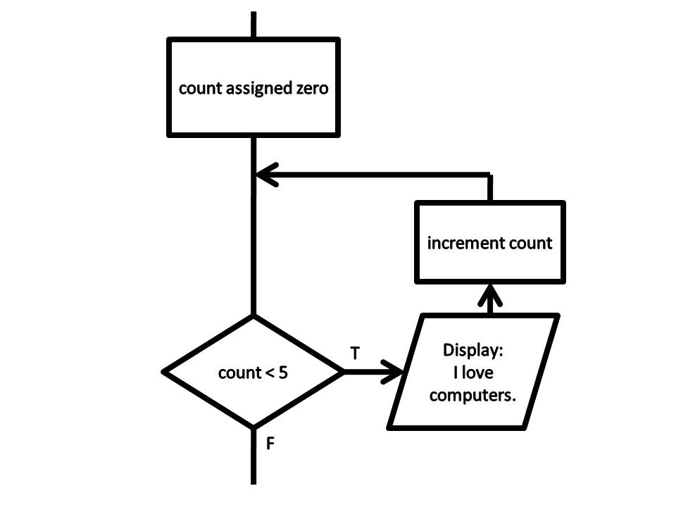

<div class="lesson-meta"><span>M04 · S07</span><span>LESSON #010</span></div>

## Why a Loop?

بدك تطبع `Hi` خمسين مرة؟ نسخ الأمر خمسين مرة صعب تعديله. `Loop` تعيد نفس الجزء طالما شرط الاستمرار متحقق.

{fig-alt="count starts at 0; test count less than 5; true displays a message and increments count; false exits" width="640"}

من [Kenneth Leroy Busbee · CC BY 3.0](https://commons.wikimedia.org/wiki/File:Flowchart_while.jpg)، دون تعديل. الرسم يبدأ من `0` ويتوقف عند `< 5`؛ مثالنا التالي يبدأ من `1` ويستعمل `<= 5`. كلاهما ينفّذ خمس مرات. الرسالة في الرسم مجرد موضع `Statement` المتكررة.

## Initialization, Condition & Update

```java
int counter = 1;
while (counter <= 5) {
    System.out.println("Hi");
    counter++;
}
System.out.println(counter);
```

`Initialization` تحدد البداية مرة واحدة. `Condition` تُفحص قبل كل دورة، ولازم نتيجتها `boolean`. `Update` تغيّر القيمة حتى نقدر نصل لنهاية هذا المثال.

| Before test | `counter <= 5` | Body | After update |
|---:|---|---|---:|
| `1` | `true` | `Hi` | `2` |
| `2` | `true` | `Hi` | `3` |
| `3` | `true` | `Hi` | `4` |
| `4` | `true` | `Hi` | `5` |
| `5` | `true` | `Hi` | `6` |
| `6` | `false` | لا تنفذ | `6` |

آخر قيمة **داخل الدورة** قبل تحديثها `5`، لكن القيمة **بعد الخروج** `6`. إذا كان الشرط `false` من البداية، لن تنفذ أي دورة.

### Infinite Loop

لو نسيت `counter++`، تبقى القيمة `1` ويبقى الشرط متحققًا. ومثلها `while (true)` ما عندها نهاية من الشرط نفسه. لا تشغّل مثالًا يطبع بلا نهاية بدون قصد؛ زر الإيقاف في `IDE` يوقف تجربة شغالة.

في الصيغة بدون `{ }` تتحكم `while` بـ `Statement` واحدة. وإذا كتبت `while (condition);` فقد جعلت الجسم فارغًا، وربما منعت التحديث الذي قصدته.

## Countdown & Step Size

بدل زيادة من `1` إلى `5`، نقدر نبدأ `5` وننقص حتى `1`:

```java
int counter = 5;
while (counter >= 1) {
    System.out.println("Hi");
    counter--;
}
```

خمس طباعات، والقيمة بعد الخروج `0`. إذا التحديث `counter -= 2`، القيم الداخلة هي `5, 3, 1` فقط، ثم الخروج عند `-1`؛ إذًا ثلاث طباعات. التحديث لازم يتحرك باتجاه يجعل الشرط يتوقف.

## Increment Inside the Condition

هذه نقطة التتبع المهمة في هذا الدرس. كل حالة في الجدول تبدأ مستقلة من `counter = 1`، والجسم يطبع القيمة فقط، دون تحديث إضافي داخله.

| Condition | Printed inside body | Final counter | Body count |
|---|---|---:|---:|
| `counter++ <= 5` | `2 3 4 5 6` | `7` | `5` |
| `++counter <= 5` | `2 3 4 5` | `6` | `4` |

**كيف وصلنا إلى `7`؟** عند آخر فحص، القيمة القديمة `6` تدخل المقارنة وتفشل، لكن `counter++` حدّثت `Variable` إلى `7` أثناء تقييم الطرف؛ فشل الشرط لا يلغي الزيادة.

في `++counter` نزيد أولًا؛ أول مقارنة تكون على `2`، وآخر مقارنة على `6`، لذلك نطبع أربع مرات فقط. لا نخلط بين قيمة `Expression` القديمة وحالة `Variable` بعد تقييمه.

## Worked Example

احفظ باسم `WhileTrace.java`. هذا يجمع ثلاث صيغ من نفس الدرس حتى تقارن نواتجها فعلًا.

```java
public class WhileTrace {
    public static void main(String[] args) {
        int counter = 1;
        while (counter <= 5) {
            System.out.print(counter + " ");
            counter++;
        }
        System.out.println("end=" + counter);

        counter = 1;
        while (counter++ <= 5) {
            System.out.print(counter + " ");
        }
        System.out.println("end=" + counter);

        counter = 1;
        while (++counter <= 5) {
            System.out.print(counter + " ");
        }
        System.out.println("end=" + counter);
    }
}
```

**Output**

```text
1 2 3 4 5 end=6
2 3 4 5 6 end=7
2 3 4 5 end=6
```

التتبع العملي: اكتب البداية، قيّم `Expression`، سجل أي تحديث داخل الشرط، نفّذ الجسم إن نجح، ثم ارجع للفحص. لا تنس آخر فحص فاشل؛ ممكن يغيّر الحالة أيضًا.

## Knowledge Check

1. من `counter = 5`، شرط `counter >= 1` وتحديث `counter -= 2`، كم مرة ندخل؟
2. هل جسم `while` مضمون مرة واحدة؟
3. لماذا `counter++ <= 5` لا تطبع نفس قيم مثال التحديث داخل الجسم؟

<details><summary>Answers</summary>

1. `3` مرات عند `5, 3, 1`، والخروج عند `-1`.
2. لا؛ تفحص أولًا وقد تدخل صفر مرات.
3. المقارنة تستخدم القديمة لكن `Variable` يتحدث أثناء تقييم الشرط، قبل دخول الجسم.

</details>

## Source & Accuracy

راجع [Subject S07](../subjects/s07.qmd) للمراجعة والأسئلة، و[Glossary](../glossary.qmd) للمصطلحات.

مراجع التحقق: [JLS §15.14](https://docs.oracle.com/javase/specs/jls/se25/html/jls-15.html#jls-15.14) · [CC BY 3.0](https://creativecommons.org/licenses/by/3.0/).
