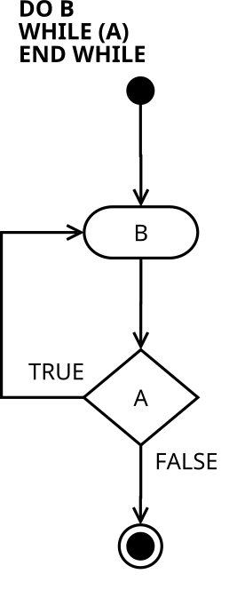

<div class="lesson-meta"><span>M04 · S08</span><span>VIDEO #012</span></div>

## Body Before Condition

`while` تفحص ثم تدخل. `do-while` تدخل ثم تفحص؛ لذلك تنفّذ جسمها مرة على الأقل عند الوصول إلها طبيعيًا، حتى لو فشل أول فحص.

{fig-alt="Do-While flow: execute statements, test condition, true returns to the body and false exits" width="270"}

من [P. Kemp · CC0](https://commons.wikimedia.org/wiki/File:Do-while-loop-diagram.svg). اتبع السهم: يصل للتعليمة قبل المعين؛ هذه هي الفكرة التي تختلف عن `while`.

```java
int counter = 0;
do {
    System.out.println("Hi");
    counter++;
} while (counter < 5);
```

يطبع `Hi` خمس مرات، ثم يخرج عند `counter = 5`. لاحظ `;` بعد `while (...)` هنا؛ هي جزء مطلوب من الصيغة، بخلاف وضعها بالخطأ بعد شرط `while` العادية.

## Compare the First Test

احفظ باسم `DoWhileDemo.java`:

```java
public class DoWhileDemo {
    public static void main(String[] args) {
        int counter = 5;
        while (counter < 5) {
            System.out.println("While body");
            counter++;
        }
        counter = 5;
        do {
            System.out.println("Do body");
            counter++;
        } while (counter < 5);
        System.out.println(counter);
    }
}
```

**Output**

```text
Do body
6
```

| Form | First action at counter = 5 | Body count |
|---|---|---:|
| `while (counter < 5)` | يفحص `false` | `0` |
| `do ... while (counter < 5)` | ينفذ الجسم ويزيد إلى `6`، ثم يفحص | `1` |

نختار الصيغة حسب المطلوب، مش لأنها «أسرع» بطبيعتها. `do-while` تناسب إدخالًا أو قائمة لازم تظهر مرة قبل تحديد قرار التكرار.

## Read Before Testing

من مثال المحارف: في `do-while` تقدر تسند القيمة داخل الجسم قبل أول فحص، دون قيمة ابتدائية مصطنعة للحرف.

احفظ باسم `DoChars.java`:

```java
import java.util.Scanner;

public class DoChars {
    public static void main(String[] args) {
        Scanner input = new Scanner(System.in);
        char letter;
        int count = 0;
        do {
            letter = input.next().charAt(0);
            if (letter != 'Q') {
                count++;
            }
        } while (letter != 'Q');
        System.out.println("Count = " + count);
    }
}
```

**Input** `A B C Q` → **Output** `Count = 3`. لو زدنا `count` دون شرط لكانت `4`، لأننا حسبنا إشارة الإنهاء أيضًا. أول إدخال `Q` يعطي `0` في الحل المعروض.

عرّفنا `letter` قبل الجسم حتى تكون متاحة في الشرط بعده. إسنادها داخل الجسم يحصل قبل كل قراءة إلها في الشرط.

## Worked Exercise: Repeated Calculator

سؤال الفيديو يرجع إلى `Calculator`: اقرأ رقمين، ثم اختر عملية، وكرر ما دامت العملية واحدة من الخمس. أي اختيار آخر ينهي. هذا يعيد بناء المثال بنفس ترتيب الإدخال؛ أضفنا فقط فحص القسمة على صفر.

احفظ باسم `RepeatedCalculator.java`:

```java
import java.util.Scanner;

public class RepeatedCalculator {
    public static void main(String[] args) {
        Scanner input = new Scanner(System.in);
        char operation;
        do {
            int first = input.nextInt();
            int second = input.nextInt();
            operation = input.next().charAt(0);
            switch (operation) {
                case '+':
                    System.out.println(first + second);
                    break;
                case '-':
                    System.out.println(first - second);
                    break;
                case '*':
                    System.out.println(first * second);
                    break;
                case '/':
                    if (second == 0) {
                        System.out.println("Cannot divide by zero");
                    } else {
                        System.out.println(first / second);
                    }
                    break;
                case '%':
                    if (second == 0) {
                        System.out.println("Cannot divide by zero");
                    } else {
                        System.out.println(first % second);
                    }
                    break;
                default:
                    System.out.println("Finished");
            }
        } while (operation == '+' || operation == '-'
              || operation == '*' || operation == '/'
              || operation == '%');
    }
}
```

**Input**

```text
5 10 *
10 8 -
0 0 Q
```

**Output**

```text
50
2
Finished
```

الأولى تطبع `50` ثم الشرط يسمح بالعودة. الثانية تطبع `2` وتعيد. الثالثة لا تطابق عملية، فتطبع `Finished` ويصبح شرط الاستمرار `false`. في هذه الصيغة البسيطة تحتاج الرقمين حتى في دورة الإنهاء، لأن قراءتهما تسبق الاختيار. بديل مذكور بالفيديو هو إشارة مثل `Q` كشرط نهاية؛ لازم تحدد هل بقية الاختيارات الخاطئة تنهي أم تعيد الطلب.

`break` داخل `switch` تخرج منها فقط؛ اللي يقرر إعادة `do-while` هو شرطها الأخير.

## Knowledge Check

1. أين نضع شرط `do-while`؟ وهل بعده `;`؟
2. إذا الشرط `false` عند أول فحص، كم مرة نكون نفذنا الجسم؟
3. لماذا استعملنا `||` بين العمليات الخمس؟

<details><summary>Answers</summary>

1. بعد الجسم: `} while (condition);`.
2. مرة واحدة، طالما لم ينته التنفيذ داخل الجسم لسبب آخر.
3. يكفي أن تكون العملية واحدة منها؛ لا يمكن للحرف أن يساوي الرموز الخمسة في نفس الوقت.

</details>

## Source & Accuracy

[Adel Nasim · #012](https://www.youtube.com/watch?v=ZRRCM0HvIn4). الجزء الثاني من الملف المجمّع، دون توقيتات. شملنا الصيغة و`;`، الفرق في أول فحص، الأنماط الثلاثة للتحكم، القراءة قبل الفحص، عد إشارة النهاية، وتكرار `Calculator`. نفس أفكار `Counter` و`Sentinel` و`Flag` تصلح مع هذه البنية؛ مكان الفحص هو الاختلاف. [Control Flow](https://dev.java/learn/language/constructs/basics/controlling-flow/) للتدقيق.
