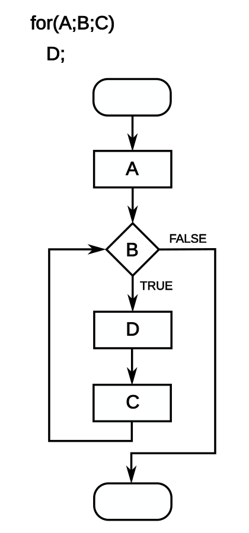

<div class="lesson-meta"><span>M04 · S08</span><span>LESSON #013</span></div>

## For Header

عرفنا `Initialization` و`Condition` و`Update` في `while`. `for` تجمعهم في مكان واحد، فتسهل مراجعة الحد والتحديث.

{fig-alt="For loop example: initialization before the condition, body on the true path, increment before the next test, and exit on false" width="350"}

من [Giacomo Alessandroni، استنادًا إلى Faxe · CC BY-SA 4.0](https://commons.wikimedia.org/wiki/File:For-loop-diagram.svg)، دون تعديل. في الرسم: `A` هي البداية، `B` هي الشرط، `C` هي التحديث، و`D` هي الجسم. [License](https://creativecommons.org/licenses/by-sa/4.0/).

```java
for (int i = 1; i <= 5; i++) {
    System.out.println("Hi");
}
```

الأجزاء الثلاثة بينها علامتا `;` داخل الأقواس. الأولى تعطي البداية **مرة واحدة فقط**، الثانية تُفحص قبل كل دورة، والثالثة تحصل **بعد الجسم** ثم نعود للشرط، لا للبداية.

## Execution Trace

| Stage | What happens |
|---|---|
| البداية | `int i = 1` مرة واحدة |
| أول فحص | `1 <= 5` → `true` |
| أول جسم | يطبع `Hi` |
| أول تحديث | `i++` تصبح `2` |
| تكرار | فحص ثم جسم ثم تحديث للقيم `2, 3, 4, 5` |
| الخروج | بعد التحديث إلى `6`، الشرط `false` |

النتيجة خمس طباعات. لو بدك تنازليًا: `for (int i = 5; i >= 1; i--)`. `for` لا تعيد `Initialization` `i = 1` كل مرة؛ لو عملت ذلك ما تقدّم العد.

## Optional Parts & Scope

ممكن تهيّئ قبلها وتترك المكان الأول فارغًا، مع الإبقاء على `;`:

```java
int i = 1;
for (; i <= 5; i++) {
    System.out.println(i);
}
System.out.println(i); // 6
```

وممكن تنقل التحديث للجسم، فتصير قريبة من `while`:

```java
int i = 1;
for (; i <= 5;) {
    System.out.println(i);
    i++;
}
```

إذا عرّفت `i` داخل رأس `for`، `Scope` الخاص فيها ينتهي بانتهاء الجملة؛ استعمالها بعدها يسبب `Compile-Time Error`. هذا موضوع `Scope`، وليس وعدًا بتوقيت تحرير `Memory` الفعلي. لو عرفتها قبل `for` داخل نفس `Scope`، تقدر تقرأها بعدها.

### Infinite Form

`for (;;)` لا تحتوي شرط توقف؛ هي `Loop` مستمرة ما لم نخرج بوسيلة داخلية. مثال توضيحي على هذه النقطة:

```java
int i = 1;
for (;;) {
    if (i > 5) {
        break;
    }
    System.out.println(i);
    i++;
}
```

يطبع `1` حتى `5`. بدون الشرط الداخلي و`break` ما في نهاية بهذه الصيغة. ما زلنا نتعلم `for` الأساسية، دون إضافة `Enhanced For` قبل وصول موضوعها.

## Worked Examples: Sum & Even Numbers

تطبيق هذا الدرس: اطبع `0–4`، اجمعها، ثم اطبع الزوجي. احفظ باسم `ForDemo.java`.

```java
public class ForDemo {
    public static void main(String[] args) {
        int sum = 0;
        for (int i = 0; i < 5; i++) {
            System.out.print(i + " ");
            sum += i;
        }
        System.out.println("sum=" + sum);

        for (int i = 0; i < 5; i += 2) {
            System.out.print(i + " ");
        }
        System.out.println();

        for (int i = 0; i < 5; i++) {
            if (i % 2 == 0) {
                System.out.print(i + " ");
            }
        }
        System.out.println();

        for (int i = 1, j = 5; i <= 3; i++, j--) {
            System.out.println(i + ":" + j);
        }
    }
}
```

**Output** · يوجد فراغ بعد آخر رقم في سطري الزوجي:

```text
0 1 2 3 4 sum=10
0 2 4
0 2 4
1:5
2:4
3:3
```

المجموع يبدأ `0` ثم يصبح `0, 1, 3, 6, 10`. طريقتا الزوجي تعطيان نفس النتيجة هنا: الأولى تبدأ بعدد زوجي وتتحرك `2`؛ الثانية تمر على كل الأعداد وتطبع ما باقي قسمته صفر. لو بدأت الأولى من `1` ستطبع الفردي؛ البداية جزء من الحل.

## Comma in the Header

آخر جزء في المثال يستعمل `,` لتعريف `Variables` من نوع `int` في البداية، وتحديثين في النهاية. كل مرة يزيد `i` وينقص `j`؛ الشرط الوحيد هنا `i <= 3`. هذا استعمال خاص في رأس `for`، مش تصريحًا بكتابة أي `Expressions` بفاصلة في أي مكان.

## Knowledge Check

1. كم مرة تُنفذ بداية `for` في تشغيل `Loop`؟
2. ما مجموع الأعداد `0–4`؟
3. هل يمكن طباعة `i` بعد `for (int i = 0; i < 5; i++)`؟

<details><summary>Answers</summary>

1. مرة واحدة؛ التكرار يرجع للشرط بعد التحديث.
2. `10`.
3. لا؛ `i` معرفة داخل `Scope` الخاص بالجملة فقط.

</details>

## Source & Accuracy

راجع [Subject S08](../subjects/s08.qmd) للمراجعة والأسئلة، و[Glossary](../glossary.qmd) للمصطلحات.

مراجع التحقق: [Control Flow](https://dev.java/learn/language/constructs/basics/controlling-flow/).
