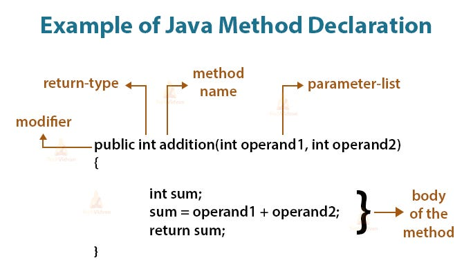

<div class="lesson-meta"><span>M05 · S10</span><span>LESSON #018</span></div>

**مرحبا**

بعد ما تعلمنا كتابة خطوات متتابعة داخل `main`، بدنا ننظّم مهمة في جزء مستقل نسميه ونستعمله كلما احتجناه.

## Method & Code Reusability

`Method` هي `Block` لها اسم وتؤدي مهمة محددة. بدل نسخ نفس `Code` عشر مرات، نكتبه مرة داخل `Method` ونستدعيها بالاسم. هذا هو `Code Reusability`، ويسهّل القراءة والتعديل و`Debugging`؛ إذا احتاجت المهمة تصحيحًا، نرجع لمكان تعريفها.

في سياق Java، نستعمل اسم `Method`. كلمة `Function` تُستخدم أحيانًا لوصف الفكرة العامة نفسها، وليست تصريحًا بكتابة `Method` خارج `Class` في أمثلتنا التقليدية.

## Declaration Parts

{fig-alt="An addition method with public modifier, int return type, two int parameters, and a body returning sum" width="684"}

رسم توضيحي من [المصدر](https://medium.com/@shourya12cbg2476/title-mastering-java-functions-and-methods-9671a562a213)، دون تعديل. يوضّح الأجزاء الأساسية؛ مثالنا التالي يضيف `static` إلى `public` حتى نستدعيه مباشرةً من `static main`.

```java
public static int addition(int operand1, int operand2) {
    int sum;
    sum = operand1 + operand2;
    return sum;
}
```

هذا `Fragment` لتعريف `Method`؛ البرنامج الكامل موجود في القسم التالي.

| Part | In this example | Role |
|---|---|---|
| Access Modifier / Access Specifier | `public` | يحدد إمكانية الوصول؛ `private` مثال آخر |
| static Modifier | `static` | يتيح الاستدعاء المباشر من `static main` في نفس `Class` دون إنشاء `Object` |
| Return Type | `int` | نوع القيمة التي ستعود؛ قد يكون `double` أو `String` أو `boolean` |
| Method Name | `addition` | الاسم المستخدم عند الاستدعاء |
| Parameters List | `int operand1, int operand2` | أسماء وأنواع تستقبل القيم بين `()` |
| Method Body | الأسطر بين `{ }` | الخطوات التي تُنفذ عند الاستدعاء |

**توضيح للدقة:** `static` ليست `Access Modifier`، وليست قاعدة تلزم كل `Method` أن تكون `static`. نستعملها هنا لتناسب الاستدعاء المباشر من `main` التقليدية. أما تفاصيل التحكم بالوصول فموضوع لاحق.

نختار `Method Name` وفق `camelCase`، مثل `printWelcome` و`calculateAverage`. بدون `Parameters` نبقي الأقواس: `printWelcome()`، ولا نحذف `()`.

## Complete Program & Call Flow

احفظ باسم `MethodDemo.java`. كل `Method` مكتوبة داخل نفس `Class` وخارج `main`؛ ممكن وضعها قبل `main` أو بعدها.

```java
public class MethodDemo {
    public static void main(String[] args) {
        printWelcome();
        int result = addition(4, 6);
        System.out.println(result);
        printWelcome();
    }

    public static void printWelcome() {
        System.out.println("Welcome");
    }

    public static int addition(int operand1, int operand2) {
        int sum;
        sum = operand1 + operand2;
        return sum;
    }
}
```

**Output**

```text
Welcome
10
Welcome
```

| Step | Execution |
|---|---|
| `printWelcome();` | ننتقل إلى جسمها، نطبع `Welcome`، ثم نرجع للسطر التالي في `main` |
| `addition(4, 6)` | تصبح `operand1 = 4` و`operand2 = 6` |
| `sum = operand1 + operand2` | تصبح `sum = 10` |
| `return sum;` | ينتهي هذا التنفيذ لـ `Method` وتعود `10` إلى مكان الاستدعاء |
| `int result = addition(4, 6);` | تُخزّن القيمة العائدة في `result` |
| `System.out.println(result);` | تُطبع `10`؛ `return` وحدها لم تطبعها |
| `printWelcome();` مرة ثانية | يُعاد تنفيذ جسمها؛ ما احتجنا نسخ سطر الطباعة في `main` |

كتابة التعريف وحدها لا تنفّذ المهمة. `Call` أو `Invoke` يعني تشغيلها باستعمال اسمها مع `()` والقيم المطلوبة. في مثالنا تبدأ الاستدعاءات من `main`، ويمكن لـ `Method` أن تستدعي أخرى أيضًا.

## Parameters vs Arguments

| Term | Where | Example |
|---|---|---|
| Parameters | في التعريف | `operand1`, `operand2` مع نوعهما `int` |
| Arguments | عند الاستدعاء | `4`, `6` في `addition(4, 6)` |

الربط حسب الترتيب: أول قيمة لأول `Parameter`، والثانية للثاني. عدد القيم وأنواعها لازم يناسب التعريف. لا يشترط أن يكون اسم `Variable` عند الاستدعاء نفس اسم `Parameter`.

## Return Type & void

- `int` أو `double` أو `String` أو `boolean` تعني أن الاستدعاء يعطي قيمة مناسبة لهذا النوع.
- `void` تعني أن الاستدعاء لا يعطي قيمة؛ مثالنا ينفّذ الطباعة ثم يرجع إلى `Caller`.
- في `Method` تعطي قيمة، كل مسار يمكن أن يصل إلى نهايتها طبيعيًا لازم يرجع قيمة مناسبة. وضع `return` داخل شرط واحد لا يكفي إذا أمكن الوصول للنهاية بدونه.
- `return` تنهي التنفيذ الحالي لـ `Method`. ليست مضطرة دائمًا أن تكون آخر سطر مكتوب في التعريف.
- داخل `void` يمكن كتابة `return;` للخروج المبكر، لكن لا يجوز `return 5;`. وقد تنتهي `void` بدون أي `return`.

**مثال خطأ:** لا يجوز `int x = printWelcome();`؛ لا توجد قيمة عائدة لتُخزن. ولا يجوز تعريف `Method` داخل جسم `main` في Java.

## Knowledge Check

1. ميّز `public` عن `static` وعن `int` في تعريف `addition`.
2. لماذا استعملنا `printWelcome` مرتين بدل نسخ جسمها؟
3. ما `Parameters` وما `Arguments` في `addition(4, 6)`؟
4. هل `return sum;` تطبع `sum`؟ وأين تذهب القيمة؟
5. هل كل `void` ممنوعة من استعمال `return`؟ وأين نكتب تعريفها؟

<details><summary>Answers</summary>

1. `Access Modifier`؛ ثم `static Modifier`؛ ثم `Return Type`.
2. لإعادة استخدام نفس المهمة وتعديل تعريفها في مكان واحد.
3. `operand1`, `operand2` في التعريف؛ و`4`, `6` عند الاستدعاء.
4. لا؛ تعود إلى مكان الاستدعاء ويمكن تخزينها أو استعمالها، ثم تطبعها أنت إذا احتجت.
5. يمكن `return;` بدون قيمة. نكتب التعريف داخل `Class` وخارج أي `Method` أخرى في هذا الأسلوب.

</details>

## Related Pages

تابع إلى [Minimum, Average & Varargs](lesson-019.qmd) ثم [S10 Partial Review](../subjects/s10.qmd). [Glossary](../glossary.qmd) للمصطلحات.

مراجع الدقة: [Oracle — Defining Methods](https://docs.oracle.com/javase/tutorial/java/javaOO/methods.html) · [Parameters & Arguments](https://docs.oracle.com/javase/tutorial/java/javaOO/arguments.html) · [Returning a Value](https://docs.oracle.com/javase/tutorial/java/javaOO/returnvalue.html). المثال الكامل جُرّب باستخدام `JDK 25` عبر `CLI`؛ ليس ادعاء تشغيل داخل `NetBeans`.
