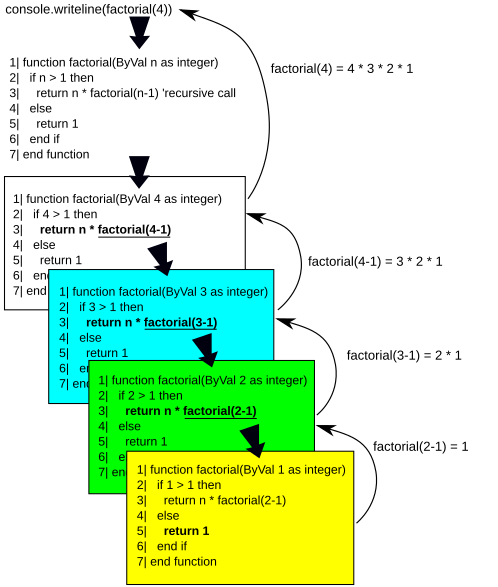

<div class="lesson-meta"><span>M05 · S11</span><span>LESSON #022</span></div>

**مرحبا**

`Recursion` تعني أن `Method` تستدعي نفسها، مباشرةً أو عبر `Methods` أخرى. الفكرة تشبه تكرار مهمة، لكن كل `Call` جديدة لها تنفيذها وقيمها. قبل كتابة الحل اسأل: **متى أتوقف، وكيف يصبح كل استدعاء أقرب للتوقف؟**

## Base Case and Progress

مثال خاطئ مقصود:

```java
static void repeat() {
    System.out.println("Hello");
    repeat();
}
```

كل استدعاء يطبع ثم يطلب استدعاء جديدًا، بلا توقف. غالبًا ينتهي التنفيذ بـ `StackOverflowError` عند استنفاد المساحة المتاحة للـ `Call Stack`، وليس بإنجاز المهمة.

الحل يحتاج:

- **Base Case:** حالة نعرف جوابها أو نتوقف عندها بدون `Recursive Call`.
- **Progress:** تغيير يجعل الاستدعاء الجديد يقترب منها.

وجود شرط مكتوب وحده لا يكفي؛ يجب أن يكون الوصول إليه ممكنًا.

## Counter Example

الأمثلة التالية أجزاء توضيحية داخل `Class`؛ تقارن موضع تحديث `Counter`:

```java
static int count = 0;
static void fourTimes() {
    count++;
    if (count < 5) {
        System.out.println("Hello");
        fourTimes();
    }
}
```

لو بدأنا من `count = 0`، نطبع أربع مرات: يصير `1,2,3,4` قبل الفحص. عند `5` لا يحدث استدعاء آخر.

```java
static int count = 0;
static void fiveTimes() {
    if (count == 5) {
        return;
    }
    count++;
    System.out.println("Hello");
    fiveTimes();
}
```

هنا نطبع خمس مرات. بدأنا بفحص `0` ثم زدناه؛ عند الاستدعاء الذي يرى `5` نرجع فورًا.

**الخطأ المقصود:** إذا وضعت `count++` بعد `fiveTimes()` فلن يصل التنفيذ إلى الزيادة قبل استدعاء جديد؛ سيظل الشرط يرى القيمة القديمة. أعد `count` إلى `0` قبل تجربة أي مثال مستقل، لأنه `static` ويحتفظ بالقيمة بين الاستدعاءات.

## Factorial: From Loop to Recursion

`5! = 5 × 4 × 3 × 2 × 1 = 120`. نقدر نحسبها بـ `Loop` تبدأ من `1` و`result = 1` ثم نضرب في كل رقم حتى `n`. في `Recursion` نكتب نفس العلاقة على صورة:

```text
factorial(0) = 1
factorial(1) = 1
factorial(n) = n * factorial(n - 1)
```

إذا توقفنا عند `1` فقط، فالاستدعاء بـ `0` ينقص إلى `-1` ثم `-2` بدل الوصول للتوقف. لازم نغطي `0!` أيضًا. الأعداد السالبة ليست ضمن مجال هذا المثال.

{fig-alt="Factorial(4) call and return diagram; values decrease toward the Base Case and results return in reverse call order" width="500"}

الصورة تعرض `factorial(4)`، والبرنامج أدناه يتيح تجربة `5` أيضًا. اقرأها كفكرة `Calls / Returns`؛ الصياغة في صورة المصدر ليست Java، والكود المعتمد هو المثال التالي. المصدر: Pluke، [CC0](https://commons.wikimedia.org/wiki/File:CPT-Recursion-Factorial-Code.svg)، دون تعديل.

احفظ باسم `FactorialDemo.java`. **Input** عدد من `0` إلى `20`، حتى تبقى النتيجة ضمن `long`:

```java
import java.util.Scanner;

public class FactorialDemo {
    public static long factorial(int n) {
        if (n == 0 || n == 1) {
            return 1;
        }
        return n * factorial(n - 1);
    }
    public static void main(String[] args) {
        int n = new Scanner(System.in).nextInt();
        if (n < 0 || n > 20) {
            System.out.println("Use 0..20");
            return;
        }
        System.out.println(factorial(n));
    }
}
```

**Input** `5` → **Output** `120`.

| Call | What it waits for | Return |
|---|---|---|
| `factorial(5)` | `5 * factorial(4)` | `5 * 24 = 120` |
| `factorial(4)` | `4 * factorial(3)` | `4 * 6 = 24` |
| `factorial(3)` | `3 * factorial(2)` | `3 * 2 = 6` |
| `factorial(2)` | `2 * factorial(1)` | `2 * 1 = 2` |
| `factorial(1)` | لا يوجد `Recursive Call` | `1` |

نقرأ عمود `Call` من فوق لتحت حتى `Base Case`، ثم نحسب `Return` من تحت لفوق. `factorial(5)` لا تحصل على `24` قبل اكتمال `factorial(4)`.

## Print Before or After the Call?

مش كل `Recursion` تطبع من تحت لفوق؛ **مكان الطباعة** يحدد ترتيبها. احفظ باسم `RecursionOrderDemo.java`:

```java
public class RecursionOrderDemo {
    static void before(int n) {
        if (n < 1) return;
        System.out.print(n + " ");
        before(n - 1);
    }
    static void after(int n) {
        if (n < 1) return;
        after(n - 1);
        System.out.print(n + " ");
    }
    public static void main(String[] args) {
        before(5);
        System.out.println();
        after(5);
        System.out.println();
    }
}
```

**Output** — يوجد Space بعد آخر رقم في كل سطر:

```text
5 4 3 2 1
1 2 3 4 5
```

في `before` تنفذ الطباعة ثم ننتقل للاستدعاء الأصغر. في `after` نؤجل الطباعة، فنصل إلى `after(0)` ونرجع إلى `after(1)` ثم `after(2)` وهكذا. كل `Call` تحتفظ بـ `n` الخاصة بها. `return;` تنهي الاستدعاء الحالي، ولا تُنهي البرنامج كله أو تمحو الاستدعاءات التي تنتظر.

## Direct and Indirect Recursion

- **Direct Recursion:** `A` تستدعي `A`، مثل الأمثلة السابقة.
- **Indirect Recursion:** `A` تستدعي `B`، و`B` تعود لاستدعاء `A`. ما زلنا بحاجة لـ `Base Case` و`Progress`.

مثال توضيحي قصير، احفظه باسم `IndirectRecursionDemo.java`:

```java
public class IndirectRecursionDemo {
    static void a(int n) {
        if (n == 0) return;
        System.out.print("A" + n + " ");
        b(n - 1);
    }
    static void b(int n) {
        if (n == 0) return;
        System.out.print("B" + n + " ");
        a(n - 1);
    }
    public static void main(String[] args) {
        a(3);
        System.out.println();
    }
}
```

**Output:** `A3 B2 A1 ` ثم سطر جديد؛ الاستدعاء الأخير `b(0)` يرجع بدون طباعة.

## Recursion vs Iteration

المسائل هنا يمكن حلّها أيضًا بـ `Loops`. `Recursion` قد تجعل الحل أقصر وأقرب لصيغة المشكلة، لكنها تحتاج عادةً مساحة `Call Stack` لكل استدعاء نشط وتضيف كلفة `Calls`. لذلك مش صحيح أنها أسرع دائمًا؛ الاختيار يعتمد على المسألة وطريقة الحل. تفاصيل `Trees` و`Algorithms` الأوسع ليست ضمن هذا الدرس.

## Knowledge Check

1. ليش وجود `Base Case` غير قابلة للوصول لا يمنع `StackOverflowError`؟
2. ما نتيجة `factorial(0)`، ولماذا يلزم دعمها؟
3. تتبع `factorial(3)`، ثم اذكر متى تبدأ النتائج بالرجوع.
4. ماذا يتغير إذا نقلنا الطباعة من قبل `Recursive Call` إلى بعدها؟
5. هل `return;` في `after(0)` توقف `main` أيضًا؟

<details><summary>Answers</summary>

1. الاستدعاءات لا تصل لشرط التوقف؛ لازم `Progress` مناسبة.
2. `1`؛ تعريف Factorial يشمل الصفر، والتناقص منه لا يصل إلى `1`.
3. `3 * factorial(2)` ثم `2 * factorial(1)` ثم `1`؛ نرجع بـ `2` ثم `6`.
4. قبلها الطباعة أثناء النزول؛ بعدها الطباعة عند الرجوع من الاستدعاءات الأصغر.
5. لا؛ ترجع إلى `after(1)` التي تكمل عملها، ثم يستمر الرجوع.

</details>

## Related Pages

[Recursion — Fibonacci & Range Sum](lesson-023.qmd) · [S11 Review & Exam](../subjects/s11.qmd) · [Glossary](../glossary.qmd).

التعريفات والأمثلة هنا تغطي التوقف وFactorial وترتيب التنفيذ، مع أمثلة مكتملة توضيحية عندما لا تتوفر الشيفرة كاملة. حدود `0..20` توضيح لمنع `long Overflow`؛ ليست إضافة موضوع جديد. جُرّبت الأمثلة عبر `JDK 25 CLI`.
