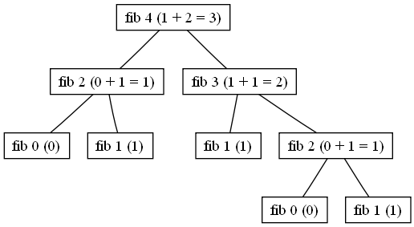

<div class="lesson-meta"><span>M05 · S11</span><span>LESSON #023</span></div>

**مرحبا**

بنستخدم الآن [Base Case وRecursive Calls](lesson-022.qmd) في ثلاثة تطبيقات: قيمة من `Fibonacci`، طباعة بداية السلسلة، ثم مجموع نطاق أرقام. المهم تقدر تشرح **ليش الاستدعاء يتوقف** و**من وين اجت النتيجة**.

## Fibonacci: Value at an Index

السلسلة تبدأ بـ `0, 1`، وكل قيمة بعدها مجموع القيمتين السابقتين:

| Index n | 0 | 1 | 2 | 3 | 4 | 5 | 6 | 7 | 8 | 9 |
|---|---|---|---|---|---|---|---|---|---|---|
| `fib(n)` | 0 | 1 | 1 | 2 | 3 | 5 | 8 | 13 | 21 | 34 |

إذًا `fib(4) = 3` و`fib(7) = 13` و`fib(9) = 34`. السؤال عن **قيمة عند Index**، مش طباعة أول `n` قيم.

```text
fib(0) = 0
fib(1) = 1
fib(n) = fib(n - 1) + fib(n - 2)
```

هون في `Base Cases` اثنتان، و`Recursive Calls` اثنتان في الحالة العامة.

احفظ باسم `FibonacciValueDemo.java`. نستعمل `0..30` كتجارب صغيرة لأن هذا الحل يعيد الحسابات كثيرًا:

```java
import java.util.Scanner;

public class FibonacciValueDemo {
    public static int fib(int n) {
        if (n == 0 || n == 1) return n;
        return fib(n - 1) + fib(n - 2);
    }
    public static void main(String[] args) {
        int n = new Scanner(System.in).nextInt();
        if (n < 0 || n > 30) {
            System.out.println("Use 0..30");
            return;
        }
        System.out.println(fib(n));
    }
}
```

**Input** `7` → **Output** `13`.

## Trace fib(4)

{fig-alt="Call tree for fib(4) showing fib(3) and fib(2), ending at fib(1) and fib(0)" width="746"}

الصورة تشرح تشعّب الاستدعاءات لـ `fib(4)`؛ ترتيب الفرعين في رسم المصدر يبدأ بـ `n-2`، وليس ترتيب التقييم في كودنا. الجدول يوضح القيم، والشرح بعده يحدد ترتيب Java. المصدر: Svick، [CC BY-SA 3.0](https://commons.wikimedia.org/wiki/File:Fib_4.png)، دون تعديل.

| Call | Split | Result |
|---|---|---|
| `fib(2)` | `fib(1) + fib(0)` | `1 + 0 = 1` |
| `fib(3)` | `fib(2) + fib(1)` | `1 + 1 = 2` |
| `fib(4)` | `fib(3) + fib(2)` | `2 + 1 = 3` |

عند تتبع السطر في Java، يكتمل `fib(n - 1)` أولًا ثم `fib(n - 2)`، ثم تُجمع النتيجتان. `fib(2)` قد تُحسب أكثر من مرة في هذا الحل؛ معرفة نتيجتها في الجدول اختصار **لتتبعنا**، وليست تخزينًا تلقائيًا داخل البرنامج. ولا ننقص `n` الأصلية بـ `n--`؛ نحن نرسل `n - 1` و`n - 2` كقيمتين مختلفتين.

## Print the First n Values

لو طلبنا خمس قيم نريد `0 1 1 2 3`، بينما `fib(5)` تعطي `5` فقط. هذه مهمة مختلفة.

نستخدم قيمتين سابقتين `first` و`second`، ونحسب `next`. طباعة `0` و`1` تتم أولًا إذا احتجناهما، ثم يبقى `n - 2` قيم.

احفظ باسم `FibonacciSequenceDemo.java`:

```java
import java.util.Scanner;

public class FibonacciSequenceDemo {
    static int first = 0;
    static int second = 1;

    static void printRemaining(int remaining) {
        if (remaining <= 0) return;
        int next = first + second;
        first = second;
        second = next;
        System.out.print(" " + next);
        printRemaining(remaining - 1);
    }
    static void printSequence(int count) {
        first = 0;
        second = 1;
        if (count <= 0) return;
        System.out.print(first);
        if (count >= 2) {
            System.out.print(" " + second);
            printRemaining(count - 2);
        }
        System.out.println();
    }
    public static void main(String[] args) {
        int count = new Scanner(System.in).nextInt();
        if (count < 0 || count > 40) {
            System.out.println("Use 0..40");
            return;
        }
        printSequence(count);
    }
}
```

**Input** `5` → **Output** `0 1 1 2 3`.

| remaining before Call | first | second | next | State after update |
|---|---|---|---|---|
| `3` | `0` | `1` | `1` | `first=1, second=1` |
| `2` | `1` | `1` | `2` | `first=1, second=2` |
| `1` | `1` | `2` | `3` | `first=2, second=3` |
| `0` | `2` | `3` | لا نحسب | نتوقف |

ليش نكتب `first = second` ثم `second = next`؟ حتى نحافظ على آخر قيمتين للحساب القادم. `next` تحتفظ بالمجموع قبل تغييرهما. أعدنا `first/second` للبداية داخل `printSequence` حتى تعمل مرة ثانية؛ ومع `0` لا نطبع شيئًا، ومع `1` نطبع `0` فقط. هاي معالجة للحدود ضمن نفس المهمة.

## Inclusive Range Sum

**المطلوب:** مجموع الأعداد بين قيمتين، شاملًا الطرفين. `sumRange(4,6) = 4+5+6 = 15`، و`sumRange(6,6) = 6`.

احفظ باسم `RangeSumDemo.java`. استعمل نطاقات صغيرة أثناء التتبع:

```java
import java.util.Scanner;

public class RangeSumDemo {
    public static long sumRange(int start, int end) {
        if (start == end) return start;
        if (start < end) {
            return start + sumRange(start + 1, end);
        }
        return start + sumRange(start - 1, end);
    }
    public static void main(String[] args) {
        Scanner input = new Scanner(System.in);
        int start = input.nextInt();
        int end = input.nextInt();
        System.out.println(sumRange(start, end));
    }
}
```

**Input** `4 6` أو `6 4` → **Output** `15`.

| Call | Waits for | Return |
|---|---|---|
| `sumRange(4,6)` | `4 + sumRange(5,6)` | `4 + 11 = 15` |
| `sumRange(5,6)` | `5 + sumRange(6,6)` | `5 + 6 = 11` |
| `sumRange(6,6)` | `Base Case` | `6` |

مع `6,4` نرسل `start - 1`، فيصبح التسلسل `6 → 5 → 4`. لو زدنا `start` دائمًا، سنبتعد عن `end` بدل الوصول إليها، وقد يحدث `StackOverflowError`. وحتى مع التقدم الصحيح، النطاق الكبير جدًا قد يستنفد `Call Stack`؛ المثال لتعلم `Recursion`، مش وعدًا بدعم أي حجم.

يمكن حل المهمة بـ `Loop` أو بصيغة مجموع أعداد متتالية: `count × (min + max) / 2`، حيث `count = max - min + 1`. لكن هدفنا هنا بناء الحل باستخدام `Recursion`، وليس استبداله بصيغة بلا تفسير.

## Knowledge Check

1. ما قيم `fib(0)` و`fib(1)` و`fib(4)`؟
2. هل طباعة أول خمس قيم تعني طباعة `fib(5)` فقط؟
3. ليش `printRemaining` تبدأ من `count - 2`؟
4. ماذا ترجع `sumRange(3,1)` و`sumRange(6,6)`؟
5. لماذا لا يكفي `start + 1` لحل المهمة في الاتجاهين؟

<details><summary>Answers</summary>

1. `0`، `1`، `3`؛ الثالثة `2 + 1`.
2. لا؛ أول خمس قيم `0 1 1 2 3`، أما `fib(5)=5`.
3. لأننا طبعنا القيمتين الأوليين مسبقًا عندما `count >= 2`.
4. `3+2+1=6`، والثانية `6`.
5. لو البداية أكبر من النهاية سنبتعد عن `Base Case`؛ نحتاج `start - 1` في هذه الحالة.

</details>

## Related Pages

[Recursion — Base Case & Return Order](lesson-022.qmd) · [S11 Review & Exam](../subjects/s11.qmd) · [One-Dimensional Arrays](lesson-024.qmd).

البرامج صيغ مكتملة للمسائل الموضحة، مع فحص حدود بسيط لضمان تجارب مناسبة. لا نضيف طرق تحسين متقدمة إلى هذا الدرس. جُرّبت عبر `JDK 25 CLI` مع الصفر والواحد واتجاهَي النطاق.
