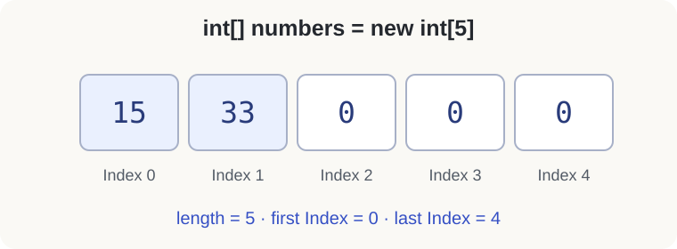

<div class="lesson-meta"><span>M06 · S12</span><span>LESSON #024</span></div>

**مرحبا**

لو بدك تحسب متوسط ثلاث قيم، ممكن تكتب ثلاث `Variables`. لكن مع مئة أو ألف قيمة؟ نحتاج **Array**: عدد محدد من `Elements` لها `Component Type` واحد، ونوصل لكل واحدة باستخدام `Index`.

تشبيه `Posts` يوضح الحاجة لمجموعة قيم بدل اسم مستقل لكل قيمة. بعض التطبيقات تستخدم هياكل قابلة للتوسع؛ هنا ندرس فقط `Array` التي يثبت طولها عند إنشائها، وليس طريقة بناء تطبيق اجتماعي.

## Create and Access

{fig-alt="An Array of five int Elements with Indices 0,1,2,3,4, corresponding values 15,33,0,0,0, and length 5" width="760"}

```java
int[] numbers = new int[5];
numbers[0] = 15;
numbers[1] = 33;
System.out.println(numbers[0]); // 15
System.out.println(numbers[1]); // 33
```

- `int[]` تحدد `Array` من `int`.
- `new int[5]` تنشئ خمس `Elements`، وليس آخر `Index` يساوي `5`.
- أول `Index` هو `0`، وآخر `Index` هو `length - 1`، أي `4`.
- كتابة `numbers[0] = 55;` لاحقًا تستبدل قيمة أول `Element`؛ الطول لا يتغير.

**تصحيح مهم:** خمس قيم `int` تحتاج `20 bytes` لقيمها نفسها، لكن كلفة `Array Object` الفعلية تشمل أيضًا بيانات تنظيمية؛ لا نحسب كامل المساحة بمجرد `5 × 4`.

الرسم توضيحي دقيق لقيم المثال، وليس Screenshot من IDE. تعذّر تنزيل الرسم الأصلي من صفحة Oracle، لذلك رُسمت القيم وIndices باستخدام SVG قابل للفحص.

## Declaration and Initialization Forms

```java
int[] first = new int[5];
int second[] = new int[5];

int[] third;
third = new int[5];

int[] fourth = {1, 8, 9, 5};
int[] fifth = new int[] {1, 8, 9, 5};
```

كلها صحيحة. نفضّل كتابة `[]` بجانب النوع. `fourth` طولها `4` لأننا أعطينا أربع قيم. لا تكتب `new int[]` بدون طول **وبدون** قيم؛ إما `new int[5]` أو `new int[]{...}`.

التصريح `int[] third;` وحده لا ينشئ `Array`؛ لازم نعطي الـ `Local Variable` قيمة قبل استخدامها.

## Default Values

عندما ننشئ `Array`، تحصل الـ `Elements` تلقائيًا على قيم ابتدائية:

| Component Type | Default Value |
|---|---|
| Numeric Types مثل `int` و`double` | `0` أو `0.0` |
| `boolean` | `false` |
| `char` | `'\u0000'`، وليست Space |
| Reference Types مثل `String` | `null` |

هذا مختلف عن `Local Variable` عادية: `int x;` داخل `Method` لا تسمح بقراءة `x` قبل إعطائها قيمة. ولا يصح استنتاج أن `String` مجرد `char[]`؛ هنا `String[]` تحتوي مراجع إلى `String Objects`.

```java
String[] names = {"Ali", "Ahmad", "Bilal"};
System.out.println(names.length); // 3
```

ممكن لاحقًا `Array` لنوع نكتبه بأنفسنا مثل `Post`؛ لن نتعمق في `Objects` الآن.

## length and Index Bounds

`numbers.length` تعطي عدد `Elements`، وبدون `()`؛ هي ليست `Method Call`.

| Expression for length 5 | Valid? |
|---|---|
| `numbers[0]` | نعم، الأولى |
| `numbers[4]` | نعم، الأخيرة |
| `numbers[5]` | لا، `ArrayIndexOutOfBoundsException` |
| `numbers[-1]` | لا، نفس نوع `Exception` |

قد يترجم `numbers[5]` بنجاح، ثم يفشل أثناء التنفيذ. لازم نلتزم بالحدود؛ لا يكفي أن `Compiler` لم يعترض.

## Traverse with for and for-each

لما بدك تمر على الكل، استخدم `Loop` بدل تكرار الطباعة يدويًا:

```java
for (int i = 0; i < names.length; i++) {
    System.out.println(names[i]);
}
```

**Output**

```text
Ali
Ahmad
Bilal
```

| i | Condition | Element |
|---|---|---|
| `0` | `0 < 3` | `names[0]` |
| `1` | `1 < 3` | `names[1]` |
| `2` | `2 < 3` | `names[2]` |
| `3` | `3 < 3` → `false` | نتوقف قبل الوصول غير المسموح |

البداية من `1` تتجاوز الأولى. وكتابة `i <= names.length` تحاول الوصول إلى `names[3]` فتفشل. ممكن استعمال `while` أو `do-while` مع ضبط الحدود، أو هذه الصيغة الأقصر للقراءة:

```java
for (String name : names) {
    System.out.println(name);
}
```

في كل مرة تأخذ `name` قيمة `Element` التالية. استعملنا نفس الفكرة سابقًا مع [Varargs](lesson-019.qmd)؛ هنا صار مصدر القيم واضحًا.

## Size Chosen at Runtime

الطول ثابت **بعد** إنشاء `Array`، لكنه مش لازم يكون رقمًا معروفًا قبل التشغيل. ممكن `int size` تأتي من المستخدم.

احفظ باسم `ArrayInputDemo.java`. **Input:** الحجم، ثم القيم المطلوبة:

```java
import java.util.Scanner;

public class ArrayInputDemo {
    public static void main(String[] args) {
        Scanner input = new Scanner(System.in);
        int size = input.nextInt();
        if (size < 0) {
            System.out.println("Size must be non-negative");
            return;
        }
        int[] numbers = new int[size];
        for (int i = 0; i < numbers.length; i++) {
            numbers[i] = input.nextInt();
        }
        for (int number : numbers) {
            System.out.println(number);
        }
    }
}
```

**Input** `3 15 33 7` → **Output** `15` ثم `33` ثم `7`، كل واحدة في سطر.

تعبير الحجم يمكن أن يكون `int` أو نوعًا يقبل التحويل إليه مثل `byte` أو `short` أو `char`، لكنه لا يقبل `long` أو `float` أو `double` مباشرةً حتى لو بدت القيمة عددًا صحيحًا. طول `0` مسموح؛ لا توجد فيه أي `Element`، والطول السالب يسبب خطأ أثناء التشغيل لو لم نفحصه.

## Knowledge Check

1. إذا `length = 4`، ما أول وآخر `Index`؟
2. لماذا لا نكتب `numbers.length()`؟
3. ما Default Values لـ `new int[2]` و`new boolean[2]` و`new String[2]`؟
4. صحّح `for(int i=1; i<=numbers.length; i++)` للمرور على الكل.
5. هل يغيّر `numbers[0] = 55` طول `Array`؟

<details><summary>Answers</summary>

1. `0` و`3`.
2. `length` هي Field في `Array`، وليست Method.
3. `0,0`؛ ثم `false,false`؛ ثم `null,null`.
4. `for (int i = 0; i < numbers.length; i++)`.
5. لا؛ تتغير قيمة `Element` الأولى فقط.

</details>

## Related Pages

[Array Exercises](lesson-025.qmd) · [Char Arrays](lesson-026.qmd) · [S12 Partial Review](../subjects/s12.qmd).

مرجع الدقة: [Dev.java — Arrays](https://dev.java/learn/language-basics/arrays/). ترتيب الأمثلة يعرض الإنشاء ثم الوصول ثم المرور، مع قيم توضيحية عند غياب الأرقام الدقيقة. جُرّب البرنامج عبر `JDK 25 CLI`.
