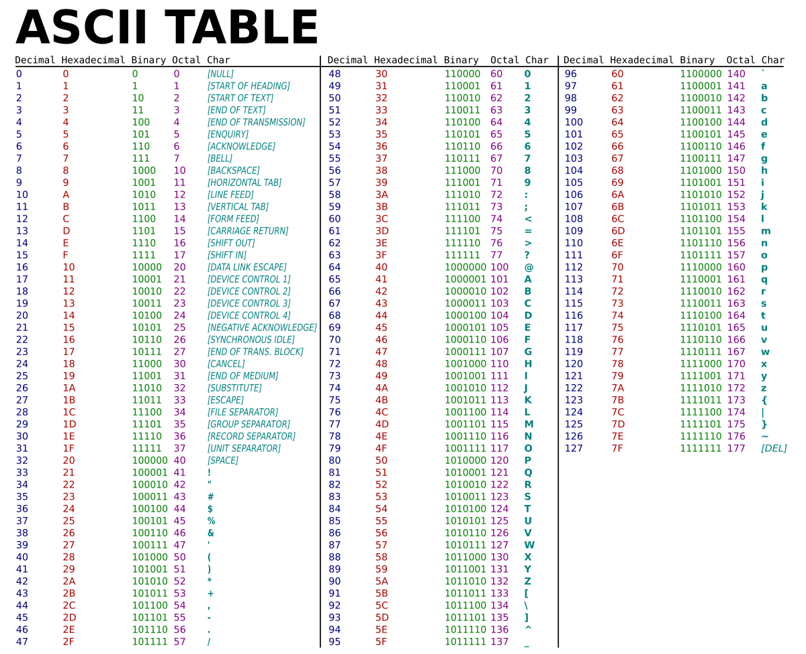

<div class="lesson-meta"><span>M06 · S12</span><span>LESSON #026</span></div>

**مرحبا**

`char[]` هي `Array` من قيم `char`. نفس أفكار [Index وlength](lesson-024.qmd) تنطبق عليها، لكن الطباعة وقراءة النصوص فيها تفاصيل مهمة.

## Create and Print char[]

```java
char[] letters = {'H', 'i'};
System.out.println(letters); // Hi
letters[1] = 'o';
System.out.println(letters); // Ho
```

نضع `char` بين Single Quotes، وليس Double Quotes الخاصة بـ `String`. في `println(char[])` توجد Overload تطبع المحتوى مباشرة، بدون `Loop`. هذا لا يعني أن طباعة `int[]` مباشرة تعمل بالطريقة نفسها، ولا أن `"Text: " + letters` يطبع المحتوى بالطريقة نفسها.

## Character Codes: ASCII and Unicode

{fig-alt="ASCII chart showing decimal codes including uppercase A 65, B 66, lowercase a 97, b 98 and digit zero 48" width="1000"}

مصدر الصورة: ZZT32 ومساهمو Wikimedia، [Public Domain](https://commons.wikimedia.org/wiki/File:ASCII-Table.svg)، دون تعديل. الصورة مرجع للرموز؛ القيم المطلوبة هنا موضّحة بحجم مقروء في الجدول التالي، فلا يلزم حفظ كل Chart.

| Character | Decimal Code |
|---|---|
| `'0'` | `48` |
| `'A'` | `65` |
| `'B'` | `66` |
| `'a'` | `97` |
| `'b'` | `98` |

الأحرف الإنجليزية المتتابعة في هذه المجموعات لها أرقام متتابعة، لذلك من بداية المجموعة نستطيع استنتاج بقية الأكواد. انتبه: `'0'` هو `Character` رمزه `48`، وليس العدد `0`.

```java
char[] codes = {97, 98};
System.out.println(codes); // ab
char capitalB = 66;
System.out.println(capitalB); // B
System.out.println((char) 66); // B
System.out.println((int) 'A'); // 65
```

القيم الثابتة `97` و`98` ضمن مجال `char`، فيقبلها المثال. أما `int code` العادية فتحتاج `Casting` مثل `(char) code` عند التحويل.

**تصحيح ضروري:** Java لا تخزن كل النصوص كـ `ASCII` فقط؛ `char` تمثل `UTF-16 Code Unit`. أكواد `ASCII` السابقة تطابق جزءًا من Unicode. بعض الرموز تحتاج قيمتي `char`، لذلك لا نعمّم أن كل رمز ظاهر يساوي `char` واحدة. لا نحتاج تفاصيل أكثر لحل أمثلة هذا الدرس.

## Input with Scanner

`Scanner.next()` تقرأ `Token` حتى الفاصل، بينما `nextLine()` تقرأ بقية السطر بما فيها Spaces. نحول `String` الناتجة بواسطة `toCharArray()`:

```java
char[] word = input.next().toCharArray();
char[] line = input.nextLine().toCharArray();
```

هذان بديلان بحسب المهمة؛ ليسا بالضرورة سطرين يُنفّذان بهذا الترتيب. إذا قرأت رقمًا قبل `nextLine()`، قد يلزم استهلاك نهاية السطر المتبقية أولًا كما شرحنا في [Scanner](lesson-006.qmd).

الطريق الأطول `String text = input.nextLine();` ثم `char[] letters = text.toCharArray();` صحيحة أيضًا؛ لا نحتاج الـ `Variable` الإضافية إذا لن نستعملها مرة ثانية.

## Length and Null Characters

```java
char[] buffer = new char[5];
buffer[0] = 'H';
buffer[1] = 'i';
```

طولها يبقى `5`، وباقي القيم `'\u0000'`، وليس Space. Java لا تحتاج حجز خانة أخيرة خاصة لإنهاء النص مثل بعض استعمالات `C Strings`؛ `Array` تعرف طولها. لكن هذا **لا يعني أن القيم غير المعبأة تُحذف** أو أن طولها يصير `2`؛ قد لا تظهر `Null Characters` بصريًا عند الطباعة.

## Sorting char[]

`Arrays.sort` ترتب قيم `char` تصاعديًا بحسب أرقامها، مش حسب ترتيب لغوي عام:

```java
char[] letters = {'a', 'C', 'B', 'A'};
java.util.Arrays.sort(letters);
System.out.println(letters); // ABCa
```

الـ Uppercase هنا قبل Lowercase: `65,66,67` أقل من `97`. ويمكن إضافة `import java.util.Arrays;` ثم كتابة `Arrays.sort(letters);`.

## Create a String from a Range

إذا احتجنا جزءًا من `char[]`:

```java
char[] letters = {'A', 'B', 'C', 'D', 'E'};
String firstTwo = new String(letters, 0, 2);
String lastThree = new String(letters, 2, 3);
System.out.println(firstTwo);  // AB
System.out.println(lastThree); // CDE
```

الصيغة `new String(letters, offset, count)` تستقبل **بداية وعددًا**، لا بداية ونهاية. `0,2` تعني قيمتين من `Index 0`، و`2,3` تعني ثلاث قيم من `Index 2`. لو طلبنا عددًا يتجاوز حدود `Array` يحدث `IndexOutOfBoundsException`؛ سنفصل التعامل مع Exceptions في قسمه المناسب.

## Complete Example

احفظ باسم `CharArrayDemo.java`. **Input:** سطر كامل:

```java
import java.util.Arrays;
import java.util.Scanner;

public class CharArrayDemo {
    public static void main(String[] args) {
        Scanner input = new Scanner(System.in);
        char[] text = input.nextLine().toCharArray();
        System.out.println(text);
        char[] codes = {97, 98};
        System.out.println(codes);
        System.out.println((char) 66);
        char[] letters = {'a', 'C', 'B', 'A'};
        Arrays.sort(letters);
        System.out.println(letters);
        char[] part = {'A', 'B', 'C', 'D', 'E'};
        System.out.println(new String(part, 0, 2));
        System.out.println(new String(part, 2, 3));
    }
}
```

**Input** `Hello Java`:

```text
Hello Java
ab
B
ABCa
AB
CDE
```

## char[] vs String

`String` لا تسمح بتعديل محتواها نفسه بعد إنشائها، بينما يمكن تعديل `Elements` في `char[]`. عند التعامل مع Password، يمكن مسح `char[]` بعد الاستعمال، لكن هذا **ليس تشفيرًا** ولا ضمانًا لإزالة جميع النسخ من Memory. كذلك لا توجد قاعدة أن `char[]` أسرع دائمًا؛ يعتمد على العملية. نختار حسب الحاجة، ولا نفضّل واحدة في كل الحالات.

## Knowledge Check

1. ما الفرق بين `'A'` و`65`، وكيف نحوّل بينهما في أمثلتنا؟
2. ما الذي يقرأ `Hello Java` كاملًا: `next()` أم `nextLine()`؟
3. ما طول `new char[5]` إذا غيّرنا قيمتين فقط؟
4. ما نتيجة فرز `{'b','A','a'}`؟
5. ماذا تعني `new String(letters, 2, 3)`؟
6. هل `char[]` تشفّر Password تلقائيًا؟

<details><summary>Answers</summary>

1. الأولى `char`، والثانية قيمة `int`؛ `(int)'A'` تعطي `65` و`(char)65` تعطي `'A'`.
2. `nextLine()`؛ الأولى تقف عند Space وتقرأ `Hello` فقط.
3. `5`؛ البقية تبقى `'\u0000'`.
4. `Aab` لأن `65 < 97 < 98`.
5. تبدأ من `Index 2` وتأخذ ثلاث قيم إذا الحدود تسمح؛ ليست نهاية عند `Index 3`.
6. لا؛ إمكانية التعديل والمسح تختلف عن التشفير.

</details>

## Related Pages

[Array Basics](lesson-024.qmd) · [Array Exercises](lesson-025.qmd) · [S12 Partial Review](../subjects/s12.qmd) · [Glossary](../glossary.qmd).

مراجع الدقة: [Character](https://docs.oracle.com/en/java/javase/25/docs/api/java.base/java/lang/Character.html) · [String Constructors](https://docs.oracle.com/en/java/javase/25/docs/api/java.base/java/lang/String.html) · [PrintStream](https://docs.oracle.com/en/java/javase/25/docs/api/java.base/java/io/PrintStream.html). البرنامج الكامل جُرّب عبر `JDK 25 CLI`. الأمثلة النصية غير المكتملة صيغت كقيم توضيحية؛ الفرق بين Unicode وASCII وبين المسح والتشفير تصحيح لنفس النقاط المطروحة.
