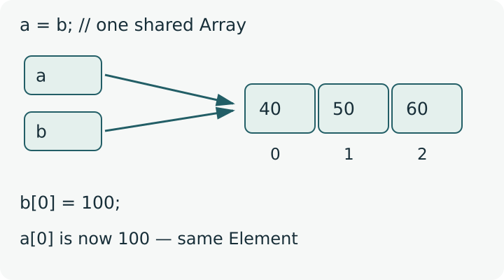

<div class="lesson-meta"><span>M06 · S12</span><span>LESSON #027</span></div>

**مرحبا**

بدل ما تضع كل الشغل داخل `main`، خلي كل `Method` مسؤولة عن مهمة واضحة: قراءة `Elements`، طباعتها، ترتيبها أو البحث بينها. نمرر لها `Array` التي ستعمل عليها. تحتاج [Array Basics](lesson-024.qmd) و[Methods](lesson-018.qmd) قبل هذا الدرس.

## Array Parameters

هذا مثال كامل؛ احفظه باسم `ArrayMethodsDemo.java`. لا يحتاج Input:

```java
public class ArrayMethodsDemo {
    static void print(int[] values) {
        for (int i = 0; i < values.length; i++) {
            if (i > 0) System.out.print(" ");
            System.out.print(values[i]);
        }
        System.out.println();
    }
    static int[] create() {
        int[] result = {4, 2, 6};
        return result;
    }
    static int[] createAnonymous() {
        return new int[]{7, 8};
    }
    public static void main(String[] args) {
        int[] first = {1, 2, 3, 4};
        int[] second = {40, 50, 60};
        print(first);
        print(second);
        print(new int[]{1, 2, 3});
        int[] returned = create();
        print(returned);
        System.out.println(returned[0]);
        System.out.println(create()[1]);
        print(createAnonymous());
    }
}
```

**Output**

```text
1 2 3 4
40 50 60
1 2 3
4 2 6
4
2
7 8
```

في التعريف نكتب `int[] values`؛ هذه `Parameter` تقبل `Array` من `int`. الصيغة `int values[]` صحيحة أيضًا، لكن سنلتزم بالأولى حتى يبقى `Data Type` واضحًا. ينطبق نفس المبدأ على `double[]` و`char[]` وغيرها، مع توافق النوع.

عند الاستدعاء نكتب `print(first)`، **اسمها بدون `[]`**. الاسم `first` عند Caller لا يلزم أن يطابق اسم `values` داخل Method. ولا نكتب طولًا داخل أقواس التعريف مثل `int[4] values`؛ الطول يخص `Array` الموجودة، وليس اسم النوع.

الـ Method تعرف الطول من `values.length`، لذلك لا تحتاج `Parameter` ثانية تحمل حجم `Array` كاملة. نعيد استعمال نفس Method مع أحجام مختلفة؛ في كل مرة تبدأ `Loop` من `0` وتتوقف قبل طول التي وصلتها.

## Anonymous Arrays

```java
print(new int[]{1, 2, 3});
```

هذه `Anonymous Array`: أنشأناها وأعطينا Reference لها مباشرةً إلى Method، بدون تعريف Variable باسم مستقل عند Caller. عدد القيم يحدد طولها. لا نكتب `print({1,2,3})`؛ هنا نحتاج `new int[]{...}`.

## Returning an Array

في المثال السابق `create()` نوعها `int[]`؛ فهي تعيد Reference إلى `Array`، وليس Element واحدة. يمكن إنشاء Array داخلها ثم `return result`، أو الإرجاع مباشرةً كما في `createAnonymous()`.

```java
int[] returned = create();
System.out.println(returned[0]); // 4
System.out.println(create()[1]); // 2
```

الاستدعاء الثاني ينشئ Array جديدة من `create()` ثم يقرأ Element عند `Index 1`. إذا ستستعمل النتيجة أكثر من مرة، احتفظ بها في Variable حتى لا تعيد تنفيذ Method بلا حاجة. في تعريف `static int[] create()` نضع الأقواس مع Return Type؛ ليست `return result[]`.

### Printing a Reference

```java
System.out.println(returned);
System.out.println(create());
```

هذان السطران **صحيحان في Java**، لكن لا يطبعان Elements. يظهر تمثيل شبيه بـ `[I@...`، والجزء الأخير يختلف؛ ليس عنوانًا ماديًا مضمونًا في Memory. استعمل `print(returned)` أو اقرأ `returned[i]`. واستثناؤنا المعروف هو `println(char[])` التي لها Overload تطبع الأحرف مباشرةً، كما في [Char Arrays](lesson-026.qmd).

## Assignment and Aliasing

{fig-alt="After a equals b, a and b refer to the same int array containing 40, 50 and 60. Updating b at index zero to 100 is visible through a." width="800"}

رسم تخطيطي دقيق؛ الأسهم تمثل References، وليست عناوين Memory فعلية.

```java
int[] a = {1, 2, 3};
int[] b = {40, 50, 60};
a = b;
b[0] = 100;
System.out.println(a[0]); // 100
a[0] = 500;
System.out.println(b[0]); // 500
```

`a = b` **لا تنسخ Elements** من Array إلى أخرى. هي تنسخ Reference، فيصير الاسمان يشيران لنفس Array. هذه الحالة اسمها `Aliasing`: أي تعديل على Element عبر أحدهما يظهر عبر الآخر. بعد Assignment، لم يعد `a` يشير إلى `{1,2,3}`.

ويمكن إضافة أكثر من اسم لنفس Array:

```java
int[] c = b;
int[] d = c;
d[0] = 0;
System.out.println(a[0]); // 0
System.out.println(b[0]); // 0
System.out.println(c[0]); // 0
```

وجود أربعة أسماء لا يعني وجود أربع نسخ من Elements؛ هنا جميعها تشير لنفس Array.

## Java Is Always Pass-by-Value

**تصحيح أساسي:** Java تستخدم `Pass-by-Value` في جميع الحالات. عندما نعطي Method قيمة `int` تنسخ الرقم؛ وعندما نعطيها Array تنسخ **قيمة Reference**. لا تنسخ Elements، ولا تعطي Method القدرة على استبدال Variable الموجودة عند Caller.

جرّب المثال الكامل باسم `ArrayPassingDemo.java`؛ لا يحتاج Input:

```java
public class ArrayPassingDemo {
    static void changeNumber(int x) {
        x = 10;
    }
    static void changeElement(int[] values) {
        values[0] = 50;
    }
    static void replaceParameter(int[] values) {
        values = new int[]{900};
    }
    public static void main(String[] args) {
        int y = 5;
        changeNumber(y);
        System.out.println(y);

        int[] numbers = {1, 2, 3};
        changeElement(numbers);
        System.out.println(numbers[0]);
        replaceParameter(numbers);
        System.out.println(numbers[0]);
        System.out.println(numbers.length);
    }
}
```

**Output**

```text
5
50
50
3
```

| Call | ما الذي نُسخ؟ | ما الذي تغير؟ | ما الذي يراه Caller؟ |
|---|---|---|---|
| `changeNumber(y)` | قيمة `5` إلى `x` | `x` المحلية فقط | `y` تبقى `5` |
| `changeElement(numbers)` | Reference إلى نفس Array | Element المشتركة عند `Index 0` | `numbers[0]` تصبح `50` |
| `replaceParameter(numbers)` | Reference إلى نفس Array | Parameter أصبحت تشير إلى Array أخرى | `numbers` ما زالت تشير للأولى |

إذًا فرّق بين **تعديل Element** وبين **إعادة Assignment للـ Parameter**. ظهور تعديل Elements عند Caller لا يجعل الآلية `Pass-by-Reference`. لا توجد صيغة Parameter مع `&` لتحقيق ذلك في Java.

## Knowledge Check

1. عرّف Method تطبع `int[]`، ثم مرر لها Array بدون تعريف اسم مستقل لها عند Caller.
2. هل تحتاج هذه Method طول Array كـ Argument إضافية؟ ولماذا؟
3. ماذا تعيد Method نوعها `int[]`؟ وكيف تقرأ أول Element من نتيجتها؟
4. إذا `b=a` ثم `b[0]=70`، ما الذي يراه `a[0]`؟ هل نُسخت Elements؟
5. لماذا تغيير `x` داخل `changeNumber` لم يغير `y`؟ ولماذا تعديل `values[0]` وصل إلى `numbers`؟
6. هل `values = new int[]{900}` داخل Method تستبدل Array التي تشير لها `numbers` عند Caller؟
7. هل `println(intArray)` خطأ Compile-Time؟ وهل يطبع محتواها أو عنوانها الفعلي؟

<details><summary>Answers</summary>

1. التعريف `static void print(int[] values)` مع Loop كما في أول مثال؛ Call هي `print(new int[]{1,2,3})`.
2. لا عند التعامل مع Array كاملة؛ نستعمل `values.length`.
3. Reference إلى Array من `int`؛ يمكن `int[] result=create()` ثم `result[0]` أو `create()[0]`.
4. `70`؛ كلاهما يشير لنفس Array، وAssignment نسخت Reference فقط.
5. في الحالتين نُسخت قيمة. الرقم مستقل داخل Parameter، أما Reference المنسوخة فتصل لنفس Array المشتركة.
6. لا؛ تتغير Parameter المحلية، بينما Reference عند Caller تبقى كما هي.
7. السطر يقبل Compile؛ يطبع Object representation مثل `[I@...`، وليس Elements ولا عنوان Memory ماديًا مضمونًا.

</details>

## Related Pages

[S12 Review & Exam](../subjects/s12.qmd) · [Multidimensional Arrays](lesson-028.qmd) · [Glossary](../glossary.qmd).

مراجع الدقة: [Oracle — Passing Arguments](https://docs.oracle.com/javase/tutorial/java/javaOO/arguments.html) · [Returning Values](https://docs.oracle.com/javase/tutorial/java/javaOO/returnvalue.html). الأمثلة الكاملة جُرّبت عبر `JDK 25 CLI`. أسماء الأمثلة وبعض القيم صيغت للتوضيح؛ تصحيح Pass-by-Value يخص نفس الفكرة التي يشرحها الدرس.
