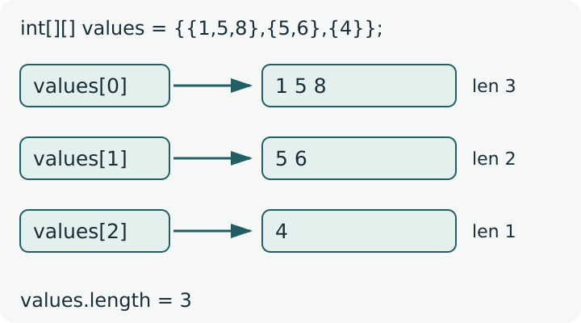
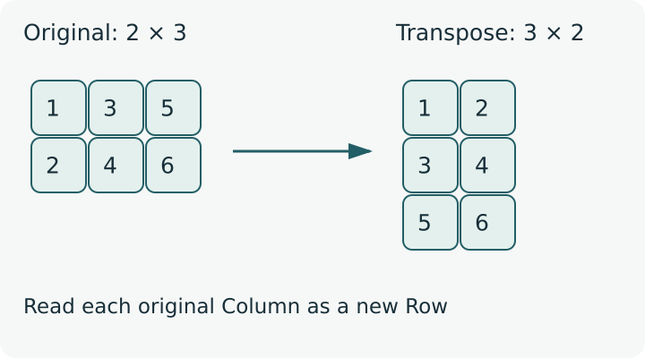

<div class="lesson-meta"><span>M06 · S13</span><span>LESSON #028</span></div>

**مرحبا**

لو عندك علامات طلاب، ولكل طالب First وSecond وFinal وTotal، فترتيبها كجدول أوضح من قائمة طويلة. كل `Row` لطالب، وكل `Column` لنوع علامة. هنا نستعمل `2D Array`. راجع [Passing Arrays](lesson-027.qmd) أولًا.

## Arrays of Arrays

{fig-alt="An outer int array of length three refers to rows containing 1 5 8, then 5 6, then 4. Row lengths are three, two and one." width="800"}

رسم تخطيطي دقيق للقيم التي سنمر عليها في الأمثلة.

في Java، `int[][]` هي **Array تحتوي References إلى Arrays من `int`**. ممكن تكون كل Rows بنفس الطول، وممكن تختلف؛ الثانية اسمها `Jagged Array` أو `Ragged Array`.

```java
int[][] values = {
    {1, 5, 8},
    {5, 6},
    {4}
};
System.out.println(values[0][0]); // 1
System.out.println(values[1][1]); // 6
System.out.println(values[2][0]); // 4
```

الوصول هو `values[row][column]`: الأولى تختار Row، والثانية تختار Element داخلها. الاثنتان تبدأان من `0`. مثلًا `values[1][1]` تعني ثاني Element داخل ثاني Row؛ لا تعني أول Row وأول Column.

## Declaration and Allocation

```java
int[][] first;
int second[][];
int[] third[];
```

كلها تعرّف نوع `int[][]`، لكن سنلتزم بالأولى لوضوحها. Declaration وحدها لا تنشئ Arrays؛ يلزم Initialization قبل الاستعمال.

### Rectangular Array

```java
int[][] grades = new int[3][4];
grades[1][2] = 18;
System.out.println(grades.length);    // 3
System.out.println(grades[1].length); // 4
System.out.println(grades[0][0]);     // 0
```

هذه ثلاث Rows، في كل واحدة أربع Elements من `int`. جميع القيم تبدأ بـ `0` قبل تغييرها. آخر Row هي `2` وآخر Column هي `3`؛ `grades[3][0]` أو `grades[0][4]` خارج الحدود.

الأحجام ممكن تأتي من Variables أو Input؛ مثلًا `new int[rows][columns]` بعد قراءة قيم صالحة. ليست محصورة بأرقام ثابتة مكتوبة داخل Code.

### Allocate Each Row Separately

```java
int[][] values = new int[3][];
values[0] = new int[3];
values[1] = new int[2];
values[2] = new int[1];
```

السطر الأول ينشئ Outer Array بطول `3`؛ References إلى Rows تبدأ `null`. الأسطر التالية تنشئ كل Row بطولها الخاص، وقيم `int` داخلها تبدأ بـ `0`. لو قرأنا `values[0][0]` **قبل** إنشاء Row الأولى يحدث `NullPointerException`؛ ليست نفس حالة الوصول إلى Index خارج الحدود.

| Expression | النتيجة |
|---|---|
| `values.length` | عدد Rows: `3` |
| `values[0].length` | طول Row الأولى: `3` |
| `values[1].length` | طول Row الثانية: `2` |
| `values[2].length` | طول Row الثالثة: `1` |

**أمثلة غير صحيحة عمدًا — Compile-Time Errors:**

```java
int[][] badA = new int[][4];
int[][] badB = new int[][];
```

عند استعمال أحجام، يجب تحديد طول Outer Array أولًا؛ لا نحدد Column ونترك Row بلا حجم. أما بدون أحجام فنعطي Initializer: `new int[][]{{1,5,8},{5,6},{4}}`. ويمكن اختصارها داخل Declaration إلى `int[][] values = {{1,5,8},{5,6},{4}};`.

## Nested Loops and for-each

احفظ المثال الكامل باسم `MatrixMethodsDemo.java`؛ لا يحتاج Input:

```java
public class MatrixMethodsDemo {
    static void print(int[][] matrix) {
        for (int row = 0; row < matrix.length; row++) {
            for (int col = 0; col < matrix[row].length; col++) {
                if (col > 0) System.out.print(" ");
                System.out.print(matrix[row][col]);
            }
            System.out.println();
        }
    }
    static int[][] create() {
        return new int[][]{{1, 5, 8}, {5, 6}, {4}};
    }
    static void changeFirst(int[][] matrix) {
        matrix[0][0] = 50;
    }
    public static void main(String[] args) {
        int[][] values = create();
        print(values);
        System.out.println("for-each:");
        for (int[] row : values) {
            for (int value : row) {
                System.out.print(value + " ");
            }
            System.out.println();
        }
        changeFirst(values);
        System.out.println(values[0][0]);
    }
}
```

**Output** — بعد كل Row في جزء `for-each` توجد Space أخيرة:

```text
1 5 8
5 6
4
for-each:
1 5 8 
5 6 
4 
50
```

الـ Outer Loop تختار Row؛ Inner Loop تمر على Elements داخل **تلك Row**. نعيد `col=0` كلما انتقلنا إلى Row جديدة، وشرطها `col < matrix[row].length` حتى تعمل مع الأحجام المختلفة. بعد Inner Loop ننتقل لسطر جديد، وليس بعد كل Element.

| Row Index | Column Indices | القيم المطبوعة |
|---|---|---|
| `0` | `0,1,2` | `1 5 8` |
| `1` | `0,1` | `5 6` |
| `2` | `0` | `4` |

لطباعة Row واحدة فقط، اختر Row ثابتة ومرّ على طولها، مثل `values[1][col]` مع `col < values[1].length`. أما `println(values[1])` فتطبع تمثيل `int[]`، وليس Elements؛ نحتاج الـ Index الثانية.

في `for-each` الخارجية، نوع Variable `int[]` لأن كل Element في Outer Array هي Row. وفي الداخلية النوع `int` لأننا الآن داخل Row نفسها.

## Passing and Returning int[][]

في `print(int[][] matrix)` نستخدم زوجين من الأقواس في Parameter، ثم نستدعي `print(values)` بدون أقواس مربعة عند Caller. لا نرسل عدد Rows أو Columns منفصلًا؛ نستخرجه من `length` للـ Array المناسبة.

والـ Return Type في `create()` هي `int[][]`؛ نستقبل النتيجة في `int[][] values`. يمكن أيضًا إنشاء Local Array داخل Method ثم `return` لها، تمامًا مثل [1D Arrays](lesson-027.qmd#returning-an-array).

النتيجة `50` بعد `changeFirst(values)` ليست مفاجأة: Parameter تستقبل **نسخة من Reference**، وتصل لنفس Outer Array ونفس Rows. هذا `Pass-by-Value` مع مشاركة Arrays، كما في الدرس السابق؛ لا نسميه `Pass-by-Reference`.

## Transpose a Rectangular Matrix

{fig-alt="A two by three matrix with rows 1 3 5 and 2 4 6 is transposed into a three by two matrix with rows 1 2, 3 4 and 5 6." width="800"}

رسم تخطيطي دقيق. في `Transpose` تصبح Rows هي Columns والعكس: قيمة `[row][col]` تظهر في الموضع `[col][row]`.

جرّب `TransposePrintDemo.java`؛ هذه طباعة بشكل Transpose، بدون تعديل Array الأصلية:

```java
public class TransposePrintDemo {
    public static void main(String[] args) {
        int[][] matrix = {{1, 3, 5}, {2, 4, 6}};
        for (int col = 0; col < matrix[0].length; col++) {
            for (int row = 0; row < matrix.length; row++) {
                if (row > 0) System.out.print(" ");
                System.out.print(matrix[row][col]);
            }
            System.out.println();
        }
    }
}
```

**Output**

```text
1 2
3 4
5 6
```

الـ Outer Loop هنا تختار Column من الأصل، والداخلية تمر على Rows لتطبع هذه Column كسطر. الأصل `2 × 3`، والطباعة `3 × 2`. لا يكفي تبديل `[row][col]` عشوائيًا مع إبقاء حدود غير مناسبة؛ قد تصل إلى Row غير موجودة.

**حدود المثال:** يفترض Matrix مستطيلة غير فارغة، وكل Rows لها نفس الطول. لا نستخدم `matrix[0].length` كحد لكل Row في Jagged Array. ويمكن وجود أبعاد أكثر مثل `int[][][]`؛ يكفي الآن معرفة أن الفكرة تتكرر، بدون الدخول بتفاصيلها.

## Knowledge Check

1. للقيم `{{1,5,8},{5,6},{4}}`، ما `length` الخارجية وطول كل Row؟ وما `values[1][1]`؟
2. ما الفرق بين `new int[3][4]` و`new int[3][]`؟
3. لماذا `new int[][4]` غير صحيحة؟
4. ما الحد الصحيح للـ Inner Loop عند اختلاف أطوال Rows؟
5. ما نوع Variable في كل من Nested for-each؟
6. اكتب Parameter وReturn Type لـ `2D Array` من `int`، ثم فسّر ظهور تعديل Element عند Caller.
7. ما أبعاد Transpose لـ `2 × 3`؟ ولماذا لم نعدل Matrix الأصلية في المثال؟

<details><summary>Answers</summary>

1. الخارجية `3`، والأطوال `3,2,1`؛ القيمة `6`.
2. الأولى تنشئ ثلاث Rows من أربع قيم تبدأ بصفر؛ الثانية تنشئ Outer Array فقط، وRows تبقى `null` حتى ننشئها.
3. يجب تحديد طول Outer Array أولًا عند Allocation بالأحجام.
4. `col < values[row].length`؛ لا نفترض طول Row الأولى للجميع.
5. `int[] row` في الخارجية، و`int value` في الداخلية.
6. `int[][] matrix` و`int[][]`؛ ننسخ Reference، فنستطيع الوصول لنفس Arrays المشتركة.
7. `3 × 2`؛ نحن غيّرنا ترتيب القراءة والطباعة فقط، ولم نضع Assignment تعدل Elements.

</details>

## Related Pages

[S13 Review & Exam](../subjects/s13.qmd) · [Strings](lesson-029.qmd) · [Glossary](../glossary.qmd).

مراجع الدقة: [Oracle — Arrays](https://docs.oracle.com/javase/tutorial/java/nutsandbolts/arrays.html) · [JLS — Arrays](https://docs.oracle.com/javase/specs/jls/se25/html/jls-10.html). الأمثلة الكاملة جُرّبت عبر `JDK 25 CLI`. Code الكاملة وأسماء Variables صيغت للتوضيح؛ ترتيب القيم في مثالي Jagged وTranspose محفوظ.
