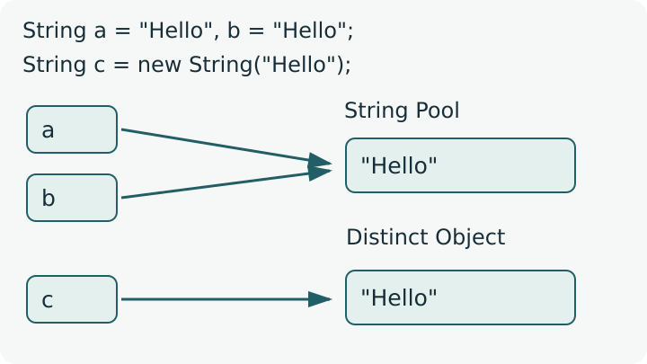

<div class="lesson-meta"><span>M06 · S14</span><span>LESSON #029</span></div>

**مرحبا**

استخدمنا `String` كثيرًا للطباعة وInput. الآن سنرتّب أهم Methods التي نحتاجها للتعامل مع النص نفسه، ثم نجمع عدة نصوص داخل `String[]`. راجع [Char Arrays](lesson-026.qmd) و[Array References](lesson-027.qmd) أولًا.

## Creating a String

```java
String first = "Hello";
String second = new String("Hello");
System.out.println(first); // Hello
```

الأولى تستخدم `String Literal` بين Double Quotes. الثانية تنشئ `String Object` بواسطة `new`. `String` هي Class داخل `java.lang`، لذلك لا تحتاج `import` لها. يكفينا الآن معرفة هاتين الصيغتين؛ تفاصيل بناء Classes وObjects تأتي في Subject الخاص بها.

الـ String أسهل من التعامل اليدوي مع `char[]` عندما تريد نصًا جاهزًا ومعه Methods للمقارنة والبحث والتقسيم. طباعة String مباشرة تطبع محتواها.

## Concatenation and Immutability

```java
String greeting = "Hello";
greeting.concat(" I am Ahmad");
System.out.println(greeting); // Hello
greeting = greeting.concat(" I am Ahmad");
System.out.println(greeting); // Hello I am Ahmad
String another = "Hello" + " I am Ahmad";
```

`concat` تضم نصًا إلى آخر وتعيد النتيجة. و`+` تعمل Concatenation أيضًا. لاحظ أن أول Call لم تغيّر `greeting`؛ السبب أن `String` تتمتع بـ `Immutability`: محتوى String Object نفسها لا يتغير بعد إنشائها. نحتفظ بالنتيجة عبر Assignment إذا أردنا استعمال النص الجديد.

نفس المبدأ ينطبق على `trim` وCase Conversion و`replace` و`substring`: ترجع نتيجة، ولا تعدّل النص الأصلي نفسه. إعادة Assignment لاسم Variable مسموحة؛ هي تغيّر Reference التي يحملها الاسم.

## String Pool and References

{fig-alt="Variables a and b initialized with the literal Hello share one pooled String. Variable c initialized with new String Hello refers to a distinct String with equal content." width="800"}

رسم تخطيطي دقيق؛ يوضّح العلاقات فقط، ولا يزعم مواقع Memory فعلية.

الـ `String Literals` المتطابقة تشترك في String محفوظة في `String Pool`. لذلك `String a="Hello"; String b="Hello";` يجعلان الاسمين يشيران لنفس String. أما `new String("Hello")` فتنشئ String Object أخرى لها **نفس المحتوى**. لا نعمّم مشاركة Pool على كل String ذات محتوى متطابق.

جرّب المثال الكامل باسم `StringIdentityDemo.java`:

```java
public class StringIdentityDemo {
    public static void main(String[] args) {
        String a = "Hello";
        String b = "Hello";
        String c = new String("Hello");
        System.out.println(a == b);
        System.out.println(a == c);
        System.out.println(a.equals(c));
        a = "Hi";
        System.out.println(b);
        a = c;
        System.out.println(a == c);
    }
}
```

**Output**

```text
true
false
true
Hello
true
```

إعادة `a="Hi"` لم تحول محتوى `b` إلى `Hi`؛ كل ما حدث أن `a` صارت تشير إلى نص آخر. أما `a=c` فتنسخ Reference الموجودة في `c`، ولذلك تصير `a==c` صحيحة.

## equals and equalsIgnoreCase

| Operation | ماذا تفحص؟ | Example | Result |
|---|---|---|---|
| `==` بين String References | هل تشيران لنفس Object؟ | `"Hi" == new String("Hi")` | `false` |
| `equals` | هل المحتوى متطابق بنفس الترتيب وCase؟ | `"Hi".equals(new String("Hi"))` | `true` |
| `equals` | اختلاف Case يفرق | `"JAVA".equals("java")` | `false` |
| `equalsIgnoreCase` | تتجاهل اختلاف Case | `"JAVA".equalsIgnoreCase("java")` | `true` |
| `equalsIgnoreCase` | لا تتجاهل حرفًا زائدًا | `"JAVA".equalsIgnoreCase("javaX")` | `false` |

إذا هدفك مقارنة محتوى String قادمة من `Scanner` أو من أي مكان آخر، استعمل `equals`. لا تختار بين `==` و`equals` بناءً على ظهور `new` أمامك؛ الاختيار حسب ما تريد فحصه. مع Primitive Values مثل `int`، `==` تقارن القيمة العددية.

## compareTo

`compareTo` تعيد `int`: سالب إذا الأولى أصغر، وصفر إذا المحتوى متساوٍ، وموجب إذا الأولى أكبر، بحسب ترتيب `UTF-16 Code Units`، وليس قاعدة لغوية لكل اللغات.

نقارن من البداية، وعند أول اختلاف نحسب قيمة Character في الأولى ناقص قيمتها في الثانية. لا نكمل المقارنة بعد أول اختلاف:

| Expression | سبب النتيجة | Result |
|---|---|---|
| `"ABCD".compareTo("ABCe")` | أول اختلاف: `'D' - 'e'` أي `68 - 101` | `-33` |
| `"Axxx".compareTo("B")` | أول Character: `65 - 66`؛ الباقي لا يغيّرها | `-1` |
| `"B".compareTo("Axxx")` | `66 - 65` | `1` |
| `"Java".compareTo("Java")` | نفس المحتوى | `0` |
| `"AB".compareTo("ABC")` | لا اختلاف في الجزء المشترك؛ نطرح الطولين `2 - 3` | `-1` |

تستطيع رؤية Code مثلًا بـ `(int)'D'`. في Conditions يكفي غالبًا فحص `< 0` أو `== 0` أو `> 0`؛ لا تفترض أن كل نتيجة سالبة تساوي `-1`.

## trim and Case Conversion

```java
String text = "  Hello Java  ";
String clean = text.trim();
System.out.println("[" + clean + "]"); // [Hello Java]
System.out.println(clean.toUpperCase()); // HELLO JAVA
System.out.println(clean.toLowerCase()); // hello java
```

`trim` تزيل ما قبل النص وما بعده من Characters التي قيمتها حتى `U+0020`، ومنها Space المعتادة؛ لا تحذف Space بين `Hello` و`Java`، ولا تشمل كل أنواع Unicode Spaces. `toUpperCase()` و`toLowerCase()` تغيران Case في **النتيجة**؛ لا تغيران `clean` نفسها. الأمثلة هنا بأحرف إنجليزية عادية؛ نتائج Case في لغات أخرى قد تعتمد على Locale.

## String.valueOf

```java
int number = 10;
String a = String.valueOf(number);
String b = number + "";
System.out.println(a); // 10
System.out.println(b); // 10
```

`String.valueOf` هي Static Method لها Overloads لقيم مختلفة، مثل `int` و`double` و`boolean` و`Object`. تحول تمثيل القيمة إلى String؛ ليست Casting من `int` إلى `String`. والضم مع نص فارغ يعطي String أيضًا. لا نفترض أن طريقة أسرع دائمًا من الأخرى.

## replace, contains, startsWith and endsWith

```java
String text = "Learn Java, Java is fun";
System.out.println(text.replace("Java", "Code"));
System.out.println("banana".replace('a', 'o'));
System.out.println(text.contains("Java"));
System.out.println(text.contains("avaJ"));
System.out.println(text.startsWith("Learn"));
System.out.println(text.endsWith("fun"));
```

**Output**

```text
Learn Code, Code is fun
bonono
true
false
true
true
```

`replace` تستبدل كل التطابقات: إما نصًا بنص، أو `char` بأخرى. المثال الأول استبدل `Java` مرتين؛ وبقيت `text` الأصلية كما هي لأننا طبعنا النتيجة فقط. `replace` هنا تبحث عن النص حرفيًا، وليست `replaceAll` التي لها قواعد Regex.

`contains` تفحص وجود نص **متجاور وبنفس الترتيب**، وليس مجرد وجود أحرفه بأي ترتيب. لبحث Character واحدة اكتب `text.contains("a")`؛ الصيغة `contains('a')` غير صحيحة لأن Method لا تقبل `char` مباشرة.

`startsWith` تفحص البداية، و`endsWith` تفحص النهاية. تقبلان نصًا من Character واحدة أو أكثر. هذه Methods حساسة لـ Case؛ مثلًا `"Java".startsWith("ja")` تعطي `false`.

## substring

```java
String text = "ABCDE";
System.out.println(text.substring(2));    // CDE
System.out.println(text.substring(0));    // ABCDE
System.out.println(text.substring(2, 4)); // CD
```

الـ Index تبدأ من `0`: الحروف `A,B,C,D,E` عند `0,1,2,3,4`.

| Form | ما الذي تأخذه؟ |
|---|---|
| `substring(begin)` | من `begin` حتى نهاية النص |
| `substring(begin,end)` | من `begin` إلى ما **قبل** `end` |

إذًا `substring(2,4)` تأخذ Index `2,3` فقط. يجب `0 <= begin <= end <= text.length()`؛ وقد ترجع نصًا فارغًا عندما الطرفان متساويان. آخر Argument هنا **End Index حصرية**، بينما `new String(chars,offset,count)` في [Char Arrays](lesson-026.qmd#create-a-string-from-a-range) تستقبل **عددًا**؛ لا تخلط بين الصيغتين.

## split and String Arrays

`split` تقسّم String حسب فاصل وتعيد `String[]`. كل Element هي String كاملة، وقد تكون كلمة أو جملة؛ ليست `char` واحدة.

احفظ المثال الكامل باسم `StringArrayDemo.java`:

```java
public class StringArrayDemo {
    public static void main(String[] args) {
        String[] parts = "A*B*C".split("\\*");
        System.out.println(parts.length);
        for (int i = 0; i < parts.length; i++) {
            System.out.println(parts[i]);
        }
        String[] names = {"Ahmad", "Mona", "Omar"};
        System.out.println(names[0]);
        System.out.println(names[0].length());
        for (String name : names) {
            System.out.println(name);
        }
    }
}
```

**Output**

```text
3
A
B
C
Ahmad
5
Ahmad
Mona
Omar
```

**تفصيل ضروري للفاصل:** `split` تستقبل `Regex`، وليس دائمًا نصًا حرفيًا. لذلك النجمة الحرفية تحتاج `"\\*"`، والنقطة `"\\."`. أما `"A,B,C".split(",")` فتعمل مباشرةً. الصيغة `split("*")` غير صحيحة وتسبب `PatternSyntaxException`. لا نحتاج الآن دراسة Regex كاملة.

في الاستعمال الافتراضي تُحذف الأجزاء الفارغة الموجودة في آخر النص؛ مثلًا `"A,B,".split(",")` تعيد `{"A","B"}`. الفاصل نفسه لا يصبح جزءًا من الكلمات الناتجة في أمثلتنا.

للتعامل مع `String[]` استخدم ما تعلمته مع Arrays: `names[0]` أول String، و`names.length` عدد Strings، و`names[0].length()` طول أول String. طباعة `names` مباشرةً لا تطبع جميع النصوص؛ نمر عليها بـ `for` أو `for-each`. تغيير `names[0]` يستبدل Reference في Array؛ لا يغير محتوى String القديمة نفسها.

## Complete Methods Example

المثال التالي يجمع Methods السابقة؛ احفظه باسم `StringMethodsDemo.java`. لا يحتاج Input:

```java
public class StringMethodsDemo {
    public static void main(String[] args) {
        String text = "  Hello Java  ";
        String clean = text.trim();
        System.out.println("[" + clean + "]");
        System.out.println(clean.toUpperCase());
        System.out.println(clean.toLowerCase());
        System.out.println("Hello".concat(" I am Ahmad"));
        System.out.println(String.valueOf(10));
        System.out.println("ABCD".compareTo("ABCe"));
        System.out.println("Axxx".compareTo("B"));
        System.out.println("B".compareTo("Axxx"));
        System.out.println("Java".compareTo("Java"));
        System.out.println("JAVA".equalsIgnoreCase("java"));
        System.out.println("Java Java".replace("Java", "Code"));
        System.out.println("banana".replace('a', 'o'));
        System.out.println(clean.contains("Java"));
        System.out.println(clean.startsWith("Hello"));
        System.out.println(clean.endsWith("Java"));
        System.out.println("ABCDE".substring(2));
        System.out.println("ABCDE".substring(2, 4));
        System.out.println(clean);
    }
}
```

**Output**

```text
[Hello Java]
HELLO JAVA
hello java
Hello I am Ahmad
10
-33
-1
1
0
true
Code Code
bonono
true
true
true
CDE
CD
Hello Java
```

## Knowledge Check

1. لماذا `s.concat("!")` وحدها لا تضمن تغيير `s`؟ وكيف تحتفظ بالنتيجة؟
2. هل كل نصين محتواهما متطابق يعطيان `true` مع `==`؟ وما الاختيار الصحيح لفحص المحتوى؟
3. احسب `"ABCD".compareTo("ABCe")`، و`"AB".compareTo("ABC")`.
4. ماذا تعطي `"  Hi Java  ".trim()`؟ وهل تُحذف Space الداخلية؟
5. صحح `text.contains('a')`، وفسر فرق `contains("ab")` عن وجود `'a'` و`'b'` بأي ترتيب.
6. ما نتيجة `"ABCDE".substring(1,4)`؟ وهل `4` عدد أم End Index؟
7. كيف تقسّم `"red*blue"`؟ وما Return Type؟
8. ما الفرق بين `names.length` و`names[0].length()`؟

<details><summary>Answers</summary>

1. String Immutable؛ نكتب `s = s.concat("!")` أو نحتفظ بالنتيجة في Variable أخرى.
2. لا؛ `==` تفحص Reference identity، و`equals` تفحص المحتوى. Literals المتطابقة حالة مشاركة، وليست قاعدة لكل Strings.
3. `-33` لأول اختلاف `68-101`؛ و`-1` لفرق الطولين بعد تطابق الجزء المشترك.
4. `Hi Java`؛ لا تحذف Space الداخلية.
5. `text.contains("a")`؛ `"ab"` يجب أن تظهر متجاورة وبنفس الترتيب وCase.
6. `BCD`؛ `4` هي End Index غير مشمولة.
7. `"red*blue".split("\\*")`؛ تعيد `String[]` فيها `"red"` و`"blue"`.
8. الأولى عدد Elements في Array، والثانية طول String الموجودة في أول Element.

</details>

## Related Pages

[S14 Review & Exam](../subjects/s14.qmd) · [M06 Exam & Project](../assessments/m06.qmd) · [Glossary](../glossary.qmd).

مرجع الدقة: [String API — JDK 25](https://docs.oracle.com/en/java/javase/25/docs/api/java.base/java/lang/String.html). الأمثلة الكاملة جُرّبت عبر `JDK 25 CLI`. أسماء Variables وبعض النصوص توضيحية؛ حدود Pool وImmutability وقواعد `split` تصحيحات لازمة لنفس العمليات المشروحة.
